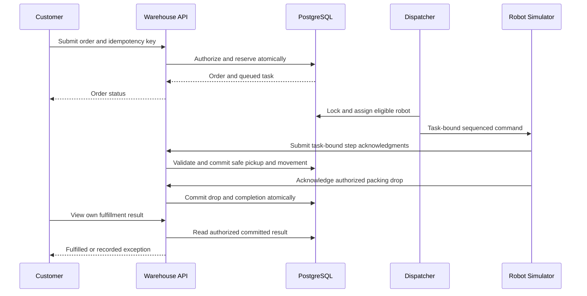

# Autonomous Warehouse Management System Agent Master Plan

**Purpose:** Build and demonstrate the assigned Autonomous Warehouse Management System for the 24CYS401 Secure Software Engineering end semester laboratory examination. Produce a working secure software model, the development workflow, and every assessment artifact in the supplied instruction document.

**Source of truth:** The two supplied photographs define the warehouse problem. The supplied Word document defines the ordered examination activities. This plan is an implementation specification and evidence checklist; it does not claim that implementation, Jira execution, testing, or deployment has already happened.

## 1 Instructions to the implementing agent

Act as the implementing software engineering agent. Follow this document from beginning to end, keeping one consistent warehouse case study throughout. Build the mandatory baseline before optional additions. Work in small, reviewable steps and maintain a record of decisions, tests, defects, and evidence as you go.

1. Read both question photographs and the Word instructions when available. Compare them with the source analysis and complete coverage ledger in this file.
2. Inspect the existing repository, installed tools, operating system, Docker, cluster, and authorized accounts. Preserve existing work. Record actual versions and capabilities.
3. Create the artifact structure, requirement register, and progress register before implementation.
4. Execute Phases 1–16 in order. Earlier phases define models and planned controls; later phases implement and verify them. When a later finding changes a model, update all affected artifacts and record the revision.
5. Use the IDs in this plan across diagrams, code comments where useful, backlog, tests, and evidence. Keep entity, process, actor, status, and component names consistent.
6. Implement real server-side authorization, persistent data, transactional stock handling, and a bounded robot simulator. A screen animation by itself is not a functioning robot workflow.
7. Run each prescribed test and capture its actual result. Never substitute expected output for observed output or label a generated diagram as execution evidence.
8. Complete the specified artifacts even when an external tool is unavailable. Clearly label the remaining external action and evidence gap. Prepared Jira CSV files do not prove a Jira project exists; manifests do not prove Kubernetes deployment; a workflow file does not prove a successful CI run.
9. Keep secrets out of source, screenshots, reports, logs, and submission archives. Use environment variables or the target platform's secret mechanism.
10. End with the final requirement-to-evidence review and a reproducible submission package. Identify anything incomplete precisely; never report completion while mandatory evidence is missing.

Use this status vocabulary in `docs/progress.md`: **NOT STARTED**, **PLANNED**, **IMPLEMENTED**, **VERIFIED**, **BLOCKED**. Only use VERIFIED when a referenced artifact or actual execution result establishes the claim. Use **NOT OBSERVED**, **FIXED**, and **RESIDUAL** for vulnerability findings as explained in Phase 7.

## 2 Analysis of the supplied problem and instructions

### 2.1 What the two photographs require

The assigned question is **23 Autonomous Warehouse Management System**. It asks for a warehouse platform in which automated robots move goods. The two photographs are consecutive parts of the same question, not two projects.

| Question requirement | Required behavior in this project |
| --- | --- |
| Inventory | Maintain products, stock by location, available and reserved quantities, and a history of stock movements and adjustments. |
| Robot registration | Register individual robot identities, capabilities, initial location, and credentials; disable or rotate credentials when needed. |
| Robot tasks | Create, assign, execute, track, complete, cancel safely, and recover tasks with defined state transitions. |
| Pickup and drop locations | Maintain valid storage, packing, charging, and transit locations; validate routes and task endpoints. |
| Order fulfillment | Accept an order, reserve stock, create tasks, assign robots, pick goods, move goods, and confirm arrival in the packing area. |
| Robot status | Show current state, position, battery, heartbeat freshness, active task, and faults. |

The combined example workflow is **Customer Order → Warehouse System → Assign Robot → Pick Item → Move Item → Packing Area**. This is the core demonstration scenario. Movement to packing is fulfillment for this baseline; courier delivery, billing, and payment are outside the supplied problem.

| Explicit security challenge | Required control and proof |
| --- | --- |
| Unauthorized robot commands | Human role checks, device identity checks, command allowlist, task binding, sequence checks, and negative authorization tests. |
| Inventory manipulation | Restricted adjustment permissions, bounded quantities, transaction constraints, ledger and audit records, and tampering tests. |
| Race conditions | Database transactions, deterministic locks, uniqueness constraints, request idempotency, and concurrent-request tests. |
| Robot collision and command conflicts | Authoritative occupancy model, serialized movement, one active task per robot, command deduplication, and collision tests. |
| Privilege escalation | Deny-by-default role and ownership policies, server-managed roles, session revocation, and role modification tests. |
| Availability | Bounded work, request throttling, timeouts, health checks, stale-device handling, resource limits, alerts, and recovery evidence. |

### 2.2 How to interpret examination examples in the Word file

The Word file explicitly ends with a **General Case-Study Instruction**: apply every phase to the separately assigned problem; no single domain is prescribed. Therefore retain each activity, count, and artifact, while adapting its example nouns to the warehouse. Do not build an unrelated student examination application.

| Generic wording appearing in the instructions | Warehouse equivalent used in all main artifacts |
| --- | --- |
| Student | Customer or order requester. |
| Faculty | Warehouse manager or fulfillment operator. |
| Administrator | System administrator. |
| Attend Examination and Submit Answers | Place Order and Submit Fulfillment Request, followed by the robot fulfillment scenario. |
| Examination component | Order and robot task orchestration component. |
| Evaluation and results | Fulfillment validation and order/status reporting component. |
| Student Exam Screen | Customer order creation and tracking screen. |
| Faculty Examination Management | Warehouse inventory, robot, and task management screen. |
| Results | Fulfillment result, delivery-to-packing confirmation, and exception summary. |
| Modifying another student's marks | Unauthorized stock adjustment or unauthorized robot task/command modification. |
| Accessing a question paper early | Accessing another customer's restricted order or private device credentials. |

Place this mapping in `docs/00_case_study_mapping.md`. Keep the original example wording in that appendix for examiner review. If the examiner later explicitly requires literal examination labels, record the clarification; do not silently replace the warehouse case study.

### 2.3 Examination constraints and completeness

- Duration stated in the Word file: **3 hours**.
- Maximum stated in the Word file: **100 marks**.
- There are **16 phases** and **64 phase activity bullets**, in addition to general instructions and final checklists.
- The individual phase marks in the supplied document sum to **99**, although its total is printed as 100. Preserve the printed phase values and note the arithmetic discrepancy without inventing an extra mark or activity.
- Every activity must be derived from the outputs before it. Cross-phase consistency is part of assessment.
- Required tools include suitable diagramming, Jira, Git/GitHub, Docker, Kubernetes/Minikube, and available CI/CD tooling.
- Submission must include diagrams, tables, source/configuration files, screenshots or other evidence, actual test results, and final observations.

## 3 Scope and implementation decisions

### 3.1 Mandatory baseline

Build one warehouse with human accounts, products, location-based inventory, customer orders, registered robots, robot tasks, a deterministic grid simulator, fulfillment reporting, security audit events, and monitoring. Deliver the complete models, workflow, security analysis, repository, container, cluster deployment, pipeline, and evidence described in the phases below.

Use simulated robots because no physical hardware, ROS integration, sensor platform, or vendor robot protocol is supplied. State this assumption explicitly. The simulator exercises device identity, commands, state transitions, inventory, and collision handling. It establishes software behavior within a discrete model; it cannot establish safety of physical warehouse machinery.

### 3.2 Recommended stack

Prefer a small modular monolith over distributed microservices for this examination. It reduces deployment and integration work while keeping clear component boundaries.

| Layer | Recommended choice | Why it fits |
| --- | --- | --- |
| Backend | Python with FastAPI and strict request models | One application can expose validated APIs, server-rendered screens, and testable services. |
| UI | Jinja templates, HTML/CSS, minimal JavaScript | Provides real usable screens without a second application build pipeline. Enable HTML autoescaping. |
| Database | PostgreSQL with SQLAlchemy and Alembic | Supports durable transactions, row locks, constraints, and versioned migrations. |
| Human authentication | Opaque database-backed sessions and Argon2id password hashing | Supports expiry, logout, revocation, and server-side role lookup. |
| Robot authentication | Independent random device tokens, stored as digests | Separates device identity from human roles; supports per-device rotation. |
| Simulator | Separate worker using the same domain services and database | Provides controlled command execution and persistent task progress. |
| Testing | pytest, an HTTP test client, property-based fuzzing with Hypothesis, and a small browser/system test | Covers normal paths, permission failures, state transitions, and malicious boundary inputs. |
| Static checks | Ruff plus Bandit; dependency audit as an additional check | Supplies automated code-quality/security results and remediation evidence. |
| Delivery | Docker Compose, Minikube/Kubernetes, GitHub Actions or available CI/CD | Meets the prescribed build, packaging, deployment, and workflow requirements. |
| Diagrams | draw.io or StarUML, with editable sources and readable exports | Supports the requested UML, ER, DFD, architecture, and attack-tree artifacts. |

At setup, choose versions supported by the lab environment, verify compatibility using official documentation, and lock exact versions. Do not write `latest` into deployment manifests or leave dependencies unbounded. Record Python, framework, database, Docker, Kubernetes, diagram tool, and CI versions in `docs/environment.md`. Alternative stacks are allowed only if the full security and evidence contract remains satisfied and all artifacts are updated consistently.

Do not replace PostgreSQL with SQLite for the concurrency demonstration: the required locking and concurrent-request behavior must be tested against the database actually deployed.

### 3.3 Optional additions after mandatory verification

Optional additions are enhancements, not substitutions for missing examination artifacts:

- Low-stock alerts, stock CSV export, and order search.
- Battery-based assignment preference and charging queues.
- A read-only warehouse map with movement animation derived from server state.
- Prometheus/Grafana, signed images, SBOM generation, and a container scan.
- Separate approval for unusually large stock adjustments.
- Multiple warehouses and more sophisticated route planning as future extensions.

Do not add payments, machine learning, real robot integration, or a large microservice system before mandatory coverage is complete.

## 4 Canonical registers and project files

### 4.1 ID convention

| Prefix | Meaning | Example |
| --- | --- | --- |
| FR / NFR / SR | Functional, non-functional, security requirement | FR-07, SR-04 |
| UC / SC | Use case and scenario | UC-04, SC-01 |
| P / D / E / F / TB | DFD process, data store, external entity, flow, trust boundary | P4, D3, F07, TB2 |
| CMP / PAT | Component and design pattern/concept | CMP-04, PAT-02 |
| A / T / V / AT | Asset, threat, vulnerability candidate, attack-tree node | A04, T05, V03, AT-02 |
| US / EP / TK | User story, epic, sprint task | US-10, EP-04, TK-US10-02 |
| UT / IT / ST / FZ | Unit, integration, system, fuzz test | UT-04, IT-01, ST-01, FZ-01 |
| DEF / RF / DC / EV | Defect, refactoring, deployment control, evidence | DEF-01, RF-02, DC-04, EV-018 |

Use business UUIDs for database records; the above IDs label engineering artifacts. Do not confuse document IDs with runtime identifiers.

### 4.2 Required file layout

| Path | Content |
| --- | --- |
| `README.md` | Project purpose, assumptions, setup, migration/seed/start/test commands, demo, troubleshooting, limitations. |
| `docs/00_case_study_mapping.md` | Sources, question transcription, domain mappings, scope decisions. |
| `docs/01_agile.md` | Agile selection, principles, risks, planned refactorings, final evidence links. |
| `docs/02_srs.md` and `docs/requirements.csv` | Requirement register and priorities. |
| `docs/03_use_cases.md` and `docs/03_analysis.md` | Two detailed critical use cases, scenario, boundary/control/entity model. |
| `docs/04_data_model.md` and `docs/04_dfd.md` | Data dictionary, cardinalities, flows, trust boundaries. |
| `docs/05_architecture.md` and `docs/06_ui.md` | Components, interfaces, patterns, screen rationales. |
| `docs/07_assets.csv`, `07_threats.csv`, `07_information_flow.md`, `07_vulnerabilities.csv` | Security analysis with linked IDs. |
| `docs/08_attack_tree.md` and `docs/08_security_refinement.md` | Attack paths and resulting design changes. |
| `docs/09_backlog.csv`, `09_sprint_plans.md`, `jira_import.csv` | Stories, tasks, goals, import material, actual Jira identifiers. |
| `docs/10_daily_scrum.md`, `10_sprint_metrics.csv`, `10_review_retrospective.md` | Actual execution and metrics. |
| `docs/11_secure_build.md` and `docs/12_refactoring.md` | Build controls, before/after code and check results. |
| `docs/13_containers.md`, `14_tests.md`, `14_defects.csv`, `15_operations.md`, `16_final_review.md` | Deployment, testing, operations and final review. |
| `docs/traceability.csv`, `docs/progress.md`, `docs/evidence_index.csv` | Complete cross-reference, phase status, and evidence catalog. |
| `diagrams/source/` and `diagrams/export/` | Editable `.drawio`/`.puml` or tool sources and SVG/PNG/PDF exports. |
| `app/api/`, `app/domain/`, `app/services/`, `app/repositories/`, `app/models/`, `app/templates/`, `app/static/` | Separated request, business, persistence, and UI concerns. |
| `worker/` | Persistent simulator and command execution loop. |
| `migrations/` and `scripts/` | Alembic migrations, seed command, safe evidence/demo helpers. |
| `tests/unit/`, `tests/integration/`, `tests/system/`, `tests/fuzz/` | Actual automated tests and reproducible fuzz cases. |
| `Dockerfile`, `compose.yaml`, `.dockerignore`, `.env.example` | Build/run configuration; example variables contain no working secrets. |
| `k8s/` | Namespace, service account, configuration, secret template, migration job, app/worker deployment, service, database/storage and policies. |
| `.github/workflows/ci.yml` or equivalent | Real CI/CD configuration. |
| `evidence/phase01/` through `evidence/phase16/` | Screenshots, command results, reports, sanitized logs. |
| `submission/manifest.md` | Final artifact inventory and reproducibility information. |

Each evidence-index row must contain `Evidence ID, Phase, Requirement or instruction ID, File, What it proves, Command or action, Timestamp UTC, Git commit, Result, Redactions`. Commit documentation and configuration along with the code. Save readable exported diagrams in addition to editable sources.

## 5 Requirements and domain rules

### 5.1 Actors and permissions

| Actor | Responsibilities and permitted scope |
| --- | --- |
| CUSTOMER | Create an order, view/cancel eligible own orders, view own fulfillment results. No stock edits or robot commands. |
| OPERATOR | View operational inventory, monitor robots and tasks, request authorized assignment, pause/resume operational work, resolve permitted exceptions. No user-role changes or arbitrary stock adjustments. |
| MANAGER | Register products/locations/robots, adjust stock with a reason, manage fulfillment, review reports; no system administrator role grants. |
| ADMIN | Manage users and roles, revoke sessions and credentials, configure access and deployment. Administrative privilege does not bypass movement or stock invariants. |
| AUDITOR | Read approved audit events and reports; no operational mutations. |
| ROBOT DEVICE | Authenticate as a particular registered device, obtain only its own commands, submit only its own heartbeat/acknowledgment. Never a human administrator. |
| DISPATCHER WORKER | Execute allowlisted internal scheduling and simulator transitions using a restricted service identity. |

Do not accept the acting user, customer owner, role, robot identity, or price/status authority from untrusted request fields. Resolve them from authenticated identities and server-side records. Public self-registration, if provided, always creates CUSTOMER; manager/admin creation is restricted. Seed demonstration accounts with passwords supplied at runtime rather than stored in the repository.

### 5.2 Functional requirements

| ID | Priority | Requirement and acceptance condition |
| --- | --- | --- |
| FR-01 | Must | Human login, logout, session expiry and revocation; expired/revoked sessions cannot act. |
| FR-02 | Must | Admin-managed roles and account status; prohibited role changes are denied and audited. |
| FR-03 | Must | Product catalog with unique SKU, name, and positive weight; invalid or duplicate data rejected. |
| FR-04 | Must | Location/map registry including storage and packing; invalid endpoints and blocked coordinates rejected. |
| FR-05 | Must | Inventory balances by product/location with available quantity and traceable adjustments. |
| FR-06 | Must | Register/disable robots, track credentials, capacity, initial position, battery and maintenance state. |
| FR-07 | Must | Create own orders with positive item quantities and stable idempotency keys; replay creates no second order. |
| FR-08 | Must | Reserve all order items atomically or reserve none; insufficient stock returns an explained conflict. |
| FR-09 | Must | Create and assign fulfillment tasks to eligible robots with valid pickup/drop locations. |
| FR-10 | Must | Execute pickup, movement and drop through valid task states; record fulfillment only after delivery to packing. |
| FR-11 | Must | Show robot status and heartbeat age; stale robots stop receiving new work. |
| FR-12 | Must | Prevent simulated collisions, duplicate task assignment and conflicting robot commands. |
| FR-13 | Must | Pause/stop operations, handle faults, cancel eligible orders and recover without duplicating stock or movement. |
| FR-14 | Must | Customer fulfillment results and manager operational reports use actual persistent state. |
| FR-15 | Must | Security audit trail for sensitive successes and failures. |
| FR-16 | Must | Health/readiness and basic metrics/alerts; capture an operational fault and recovery. |
| FR-17 | Should | Inventory search, filters and low-stock indication. |
| FR-18 | Could | Read-only export, battery-aware assignment and richer dashboard charts. |

### 5.3 Non-functional and security requirements

| ID | Requirement | Verification |
| --- | --- | --- |
| NFR-01 | Proposed lab performance target: p95 read API latency under 500 ms at 10 concurrent users on the recorded machine. | Run a bounded measurement and report actual conditions/results; do not claim a production SLA. |
| NFR-02 | Correctness under concurrency: no overselling, duplicate active robot assignment or duplicate stock movement. | PostgreSQL concurrency and replay tests. |
| NFR-03 | Persist tasks/orders and resume safely after worker restart. | Kill/restart worker during an active task and check ledger and sequence consistency. |
| NFR-04 | Usable keyboard navigation, labels, readable contrast and status feedback. | Screen review and end-to-end flow. |
| NFR-05 | Reproducible setup with migrations, locked dependencies and documented commands. | Fresh setup from repository. |
| NFR-06 | Bound request sizes, quantities, pagination, retries and simulator work. | Limits tests and fuzzing. |
| NFR-07 | UTC timestamps, consistent identifiers and observable errors. | Audit/error tests and evidence correlation. |
| NFR-08 | Maintainable service boundaries with tests around business rules. | Component-to-code comparison and refactoring review. |
| SR-01 | Password hashing, random session tokens, short idle/absolute expiry and session revocation. | Password/session unit tests and logout/expiry system test. |
| SR-02 | Least-privilege role checks and object ownership on every protected operation. | Role/ownership negative tests. |
| SR-03 | Independent device identity and command/task binding. | Wrong-device and customer-command tests. |
| SR-04 | Authorized robot assignment is atomic, replay-safe and preserves one active task per robot. | IT-01 concurrency/replay tests. |
| SR-05 | Stock changes are validated, atomic, nonnegative and recorded in a movement ledger. | Stock reservation/adjustment/pick/drop tests. |
| SR-06 | Protected sensitive events have attributable audit records; unauthorized edits to audits are denied. | Audit permissions and event tests. |
| SR-07 | Sensitive network traffic uses TLS in the secure target profile. | Target connection check and environment evidence. |
| SR-08 | No hard-coded secrets; exclude credentials from source, image layers, evidence and logs. | Secret scan, image/config review, log inspection. |
| SR-09 | Defend cookie-authenticated state-changing requests against CSRF; prevent script/SQL injection. | Missing/wrong CSRF token tests, output escaping and parameterized queries. |
| SR-10 | Rate limits, body limits, timeouts and stale-device detection preserve bounded availability. | Throttle/heartbeat/timeout tests. |
| SR-11 | Enforce legal state transitions, capacity/battery/location rules and collision checks server-side. | State, capacity and map tests. |
| SR-12 | Non-root containers, restricted Kubernetes exposure and minimum platform privileges. | Runtime and manifest/deployment inspection. |
| SR-13 | Protected repository, automated security gate and integrity-linked build/package. | Repository settings, pipeline run and artifact digest. |

For each requirement add stakeholder, rationale, CIA classification, related use case, acceptance test, story, and evidence references to the SRS register. Integrity and availability are especially important for stock and commands; confidentiality still matters for credentials and customer data. Use Must/Should/Could/Won't as MoSCoW priorities; Won't means explicitly outside this examination baseline, not omitted mandatory work.

### 5.4 Business invariants

1. `on_hand >= 0`, `reserved >= 0`, and `reserved <= on_hand` for every product/location balance. Available stock is `on_hand - reserved`.
2. One stock balance exists per warehouse/product/location. One SKU identifies one product within this baseline.
3. Every order quantity is a bounded positive integer. Never accept floats, booleans, negative values, or arbitrary huge values as quantities.
4. At most one active task owns a robot. Active states are ASSIGNED, TO_PICKUP, PICKING, TO_DROP, DROPPING and BLOCKED.
5. A task always belongs to an order item and identifies pickup, packing drop, quantity, robot when assigned, and valid state.
6. Only an eligible IDLE robot with fresh heartbeat, adequate capacity/battery and a valid position can be assigned.
7. Commands are allowlisted and bound to a registered robot and task. Command sequence and state must match server expectations.
8. Two active robots cannot occupy the same grid cell. No direct cell swap or traversal through an occupied cell is permitted.
9. Order fulfillment is COMPLETE only when every required quantity has reached its assigned packing location and corresponding task/ledger effects are committed.
10. Only controlled adjustment and movement operations alter stock. Role changes, cancellation and errors cannot bypass these rules.
11. Time comes from the server; clients cannot override expiry, heartbeat freshness or movement tick authority.
12. A paused warehouse permits observation and authorized recovery, but no normal assignment or movement.

## 6 Data, state transitions and concurrency specification

### 6.1 Entity and data dictionary blueprint

| Entity | Essential attributes and constraints | Relationships |
| --- | --- | --- |
| User | UUID PK, normalized unique login, password_hash, role enum, active, created_at, role_version. | One user owns many orders/sessions/audit actions. |
| Session | UUID PK, user FK, token_digest unique, csrf_digest, expires_at, revoked_at, created_at. | Many sessions to one user. |
| Warehouse | UUID PK, name. | One warehouse to many locations, robots, balances and orders. |
| WarehouseControl | warehouse FK/PK, paused, stop_reason, current_tick, version. | One control row per warehouse; serialized movement lock. |
| Location | UUID PK, warehouse FK, code, type, x, y, blocked; unique warehouse/code and warehouse/x/y. | One location to many stock balances and task endpoints. |
| Product | UUID PK, unique SKU, name, weight, active. | One product to many balances and order items. |
| InventoryBalance | UUID PK, warehouse/product/location FKs, on_hand, reserved, version; quantity checks and unique triple. | One balance to many reservations and movement records. |
| Order | UUID PK, warehouse FK, customer FK, status, created_at, version. | One order to many items and reservations via items. |
| OrderItem | UUID PK, order/product FKs, requested_qty, delivered_qty; checks. | One item to one or more reservations/tasks when sourcing stock from multiple locations. |
| StockReservation | UUID PK, order_item FK, balance FK, qty, state, version. | Each reservation sources a single balance and owns a fulfillment task. |
| Robot | UUID PK, warehouse FK, unique serial, token_digest, status, capacity, battery, current_location FK, last_seen, version. | One robot to many historical tasks/commands. |
| Task | UUID PK, reservation FK unique, robot FK nullable, pickup/drop FKs, state, resume_state, quantity, attempt, timestamps. | A reservation has at most one task record in this baseline; recovery revises it with an audited attempt. |
| Command | UUID PK, robot/task FKs, sequence, type, expected_state, status, claimed_by, lease_until, created_at, expires_at; unique robot/sequence. | One robot/task to many commands. |
| InventoryMovement | UUID PK, reservation FK nullable, product FK, from/to location FKs nullable, qty, type, source_event unique, reason, actor, created_at. | Records reservation pickup, packing drop or controlled external adjustment. |
| IdempotencyRecord | UUID PK, actor identity, endpoint, key, request_hash, response_ref, status; unique actor/endpoint/key. | Links safe replay to one original business operation. |
| AuditEvent | UUID PK, timestamp, actor identity/type, action, target, outcome, reason_code, request_id, sanitized metadata. | References affected business records without storing credentials. |

Show PKs, FKs, candidate uniqueness, optionality and cardinalities in the ER diagram. Identify cascade/restrict rules explicitly: do not cascade-delete historical tasks, movements or audit evidence when a user/product/robot is disabled. The exact minimum implementation can normalize or consolidate tables if documented, but it must retain every invariant and relationship.

### 6.2 Stock lifecycle

- **Reservation:** Lock the relevant balances in a deterministic order. Verify available stock for all requested items, then increment `reserved` and create RESERVED reservation records in the same transaction. Roll back the whole order reservation if any item cannot be satisfied.
- **Pickup:** Verify robot identity, task state and robot at pickup. In one transaction decrement source `on_hand` and `reserved` by the reservation quantity, change reservation to PICKED, append a uniquely keyed PICK movement and advance the task. PICKED quantity is in transit and is not available stock.
- **Drop:** Verify robot at the authorized packing location. Create or lock the destination balance, increment its `on_hand`, mark reservation DELIVERED, append a uniquely keyed DROP movement and advance delivered quantities/task/order states atomically.
- **Cancellation before pickup:** Only release quantities still RESERVED. Cancel safely under the same command/task locks so execution cannot start concurrently. Return the robot to IDLE only after its assigned task is no longer executing.
- **Failure after pickup:** Do not restore stock to the source automatically. Hold the item as PICKED/in-transit or QUARANTINED with an incident record. A manager-authorized recovery delivers it to packing or records a real return movement exactly once.
- **Adjustment:** Manager provides a bounded signed change and mandatory reason. A reduction cannot leave `on_hand < reserved`. Record the external receipt/loss/count correction in the ledger. Reject invalid balances.

For every product, check conservation: **sum of location on_hand + quantity currently in transit = initial total + legitimate external adjustment deltas**. Packing stock remains inside the warehouse total. Shipping beyond packing is not implemented in the baseline. Reservation counts must equal the sum of active RESERVED reservation quantities for each balance.

### 6.3 State machines

| Object | Allowed progression and exceptions |
| --- | --- |
| Order | CREATED → RESERVED → IN_PROGRESS → FULFILLED. CREATED/RESERVED can become CANCELLED before pickup; operational failure becomes NEEDS_ATTENTION and requires explicit recovery. |
| Reservation | RESERVED → PICKED → DELIVERED. RESERVED → RELEASED on safe pre-pick cancellation. PICKED → QUARANTINED on a recorded incident, then controlled recovery. |
| Task | QUEUED → ASSIGNED → TO_PICKUP → PICKING → TO_DROP → DROPPING → COMPLETED. Active states can enter BLOCKED with `resume_state`; recovery re-enters that valid state. Safe pre-pick cancellation → CANCELLED; unrecoverable operational failure → FAILED with stock reconciliation. |
| Robot | IDLE → BUSY → IDLE for successful work; BUSY → BLOCKED during an obstacle/fault; any applicable state → OFFLINE after heartbeat loss. MAINTENANCE and recovery require authorized actions. Never set IDLE while an unresolved active task still owns the robot. |
| Command | PENDING → CLAIMED → ACKNOWLEDGED, or FAILED/EXPIRED. Acknowledge a command only with its authorized task/state/sequence effects. Retry is idempotent. |

Separate a robot's heartbeat state from its task ownership. An OFFLINE robot with goods/task outstanding retains that ownership until reconciled. Do not assign its task to a second robot while pretending the goods remained at the rack.

### 6.4 Atomic assignment and request idempotency

Implement a shared domain service rather than separate copies of assignment logic in UI, API and worker:

1. Authenticate the caller and authorize assignment for the warehouse and order.
2. Require an idempotency key for order creation, task assignment and manual command requests. Limit key length; store a hash of the canonical validated request.
3. Begin one business transaction and acquire/update the actor-scoped idempotency record within it. Same key and same body returns the original result; same key and different body returns conflict. Concurrent callers using one key must converge on one result. A failed business transaction must not leave a falsely successful or permanently pending idempotency record.
4. In that same transaction take the warehouse control row lock when coordinating robots. Verify warehouse is not paused.
5. Lock relevant order, inventory/reservation and robot/task records in the documented consistent order.
6. Re-read current state under lock, verify stock reservation, robot eligibility, endpoints and capacity, then assign the queued task and mark robot BUSY.
7. Insert the uniquely sequenced command and attributable audit event in the transaction. The command table serves as the persistent dispatch queue.
8. Commit once. Return stable identifiers. Roll back all mutations on validation/authorization/conflict failure.
9. Handle unique-constraint and lock-timeout failures as controlled conflicts/retries, with bounded attempts and safe error responses.

Add a PostgreSQL partial unique index that prevents two active tasks with the same non-null robot ID. Enforce unique command sequences and unique inventory movement source events. Application checks alone are insufficient.

Claim commands with a recorded worker identity and bounded lease. After a crash, inspect persisted command/task/ledger state before retrying an expired claim. If effects were already committed, return the prior acknowledgment without repeating them. In this database-backed simulation the command acknowledgment and its stock/movement effects commit together. A failed or expired command enters a recorded task recovery path; it never silently completes the order or releases picked goods. Real device networks would require additional reconciliation because a physical action and a database commit are not one atomic transaction.

Use the same lock order everywhere: warehouse control first if needed, then orders, balances, reservations, robots, tasks and commands in stable ID order. An operation that started by locking balances must not later take the warehouse control lock. Explain deadlock handling and test the multi-item reservation case.

### 6.5 Collision-safe simulator baseline

Use a small explicit grid, blocked cells and one occupied cell per robot. Store the authoritative robot location in PostgreSQL. A simple path search such as BFS can calculate routes, but path calculation alone does not grant movement permission.

For the baseline, process **one adjacent robot movement at a time under the WarehouseControl row lock**. Re-read occupancy inside that transaction, validate adjacency and cell availability, and commit location, movement tick and command effect together. Add uniqueness for occupied robot cells within the warehouse. Keep database movements serialized even if the app has multiple processes. A Python lock inside one process is not sufficient.

- Reject movement into blocked/out-of-bounds/occupied cells.
- Prohibit direct A↔B swaps because the destination is still occupied when either move is attempted.
- Keep a waiting robot BLOCKED and preserve its goods/task ownership when no safe step exists.
- Detect prolonged blocking with a bounded tick/time threshold, emit an alert and require safe route reconsideration or operator recovery. Never teleport, release picked stock or ignore occupancy to resolve deadlock.
- Keep polling loops, route searches and retries bounded; no unbounded task creation or tight CPU loops.
- Pause/stop must acquire the same control lock as movement, so after the stop transaction commits no normal move commits without a subsequent authorized resume.
- Record movement decisions and rejected conflicts. A UI map refreshes from committed state; it does not dictate robot positions.

This conservative simulator trades throughput for straightforward correctness in the lab. Continuous geometry, stopping distances, sensors, multi-cell loads and physical emergency-stop hardware remain future work.

Configure packing bays off the main transit corridor, with at least one distinct accessible drop cell per demonstration robot. A completed robot remains at its actual bay until a subsequent authorized task moves it; do not reset its position to a home cell when marking it IDLE. Reserve/select an appropriate bay during task planning and validate occupancy again for every step. A parking/reposition task is a later extension if the deployment needs more flexible bay clearance.

## 7 Phase 1 Agile Process and Development Approach

**Marks in source: 6. Output:** `docs/01_agile.md`, principle mapping, planned and later completed RF-01/RF-02 evidence, risks and mitigations.

### Steps

1. Select **Scrum with XP practices**. Explain two sprint goals, short feedback loops, small working increments, test-driven critical rules, continuous integration and refactoring.
2. Define Product Owner, Scrum Master and Developer/Tester responsibilities. In an individual lab these can be explicit responsibilities held by one student; do not invent team members.
3. Map at least five Agile Manifesto principles; use the seven project-specific mappings below.
4. Identify RF-01 and RF-02 now. Save their planned target and success criterion; add real before/after evidence when Phase 12 executes the fixes.
5. Record two or more Agile risks with actual mitigations.
6. Define Definition of Ready and Definition of Done. A story is not Done until code, negative tests, security checks, docs and evidence pass.

| Agile principle | Warehouse application |
| --- | --- |
| Early and continuous delivery | Sprint 1 demonstrates authenticated stock/order reservation; Sprint 2 demonstrates robot fulfillment and delivery controls. |
| Welcome changing requirements | Record changed location/permission assumptions and update all dependent models before accepting the change. |
| Deliver working software frequently | Review a runnable small increment rather than only screenshots of proposed screens. |
| Business and developers collaborate | Use a recorded warehouse-manager review or stated lab role to validate stock and fulfillment rules. |
| Working software measures progress | Count only accepted working stories; planned story points and generated UI do not prove completion. |
| Technical excellence and good design | Add state-machine, authorization and concurrency tests around the most sensitive rules. |
| Regular reflection and adaptation | Retrospective identifies at least two concrete changes to the next iteration. |

RF-01: Replace mixed route/controller logic with validated request schemas, authorization policy, TaskAssignmentService and repository transactions. RF-02: Replace non-atomic read-then-update stock/robot handling with locked transactions, constraints, idempotency and an auditable movement service.

Risk 1: feature pressure can defer security controls. Mitigate with mandatory security acceptance criteria and a security gate. Risk 2: changing rules can make diagrams and code inconsistent. Mitigate with linked IDs, change records and phase consistency checks. Also record the single-student/timebox limit; mitigate through the lean baseline and realistic evidence capture.

**Gate:** approach justified; at least five mappings; two refactoring targets; two risks with mitigations; evidence placeholders explicitly planned.

## 8 Phase 2 Requirements Engineering

**Marks: 7. Output:** concise SRS and requirements table in `docs/02_srs.md` and CSV.

1. List stakeholders: customer, operator, manager, administrator, auditor, robot/device integrator and deployment maintainer. Include the Student/Faculty/Administrator adaptation from Section 2.
2. Adopt the FR, NFR and SR registers in Section 5 and refine to the implementation environment. Keep the six photo capabilities and six named security challenges visible.
3. For each requirement include ID, type, stakeholder, statement, rationale, priority, measurable acceptance, CIA relevance, dependency and related use case.
4. Explicitly classify confidentiality, integrity and availability. Add authentication, authorization and audit requirements separately; do not write only a generic requirement that the system is secure.
5. Document assumptions: one warehouse, deterministic simulated robots, fulfillment ends at packing, bounded grid/quantities, and lab performance targets.
6. Record out-of-scope items and conflicts. Do not silently downgrade a mandatory source requirement to an optional feature.

**Gate:** every requirement is testable and prioritized; role/ownership restrictions and concurrency/collision rules are explicit.

## 9 Phase 3 Requirements Analysis and UML

**Marks: 7. Output:** UML use-case diagram, two full critical specifications, scenario-based analysis model.

### 9.1 Use-case diagram

Create a genuine UML use-case diagram with actors, a system boundary and labeled associations. Do not submit a generic flowchart as the UML use-case diagram.

| Use case | Actors | Requirement links |
| --- | --- | --- |
| UC-01 Authenticate and End Session | Human users | FR-01, SR-01 |
| UC-02 Manage Users and Roles | ADMIN | FR-02, SR-02 |
| UC-03 Manage Catalog Locations and Stock | MANAGER; OPERATOR reads | FR-03–05, SR-05 |
| UC-04 Place Order and Submit Fulfillment Request | CUSTOMER | FR-07–08, SR-02, SR-05 |
| UC-05 Register and Maintain Robot | MANAGER/ADMIN for their permitted actions | FR-06, FR-11, SR-03 |
| UC-06 Assign Robot and Execute Fulfillment Task | OPERATOR/MANAGER, DISPATCHER, ROBOT DEVICE | FR-09–12, SR-03–04, SR-11 |
| UC-07 Cancel Pause Stop and Recover | CUSTOMER for eligible own cancellation; OPERATOR/MANAGER for operational actions | FR-13 |
| UC-08 View Fulfillment Results | CUSTOMER own data; MANAGER reports | FR-14, SR-02 |
| UC-09 Review Audit and Health | AUDITOR, ADMIN, authorized MANAGER | FR-15–16, SR-06 |

Use UC-04 `<<include>>` Validate Order and Reserve Inventory. Use UC-06 `<<include>>` Authorize Operation, Validate Robot Eligibility and Record Task/Audit Event. Use Handle Robot Fault `<<extend>>` Execute Fulfillment at the defined fault condition. Include represents always-required reusable behavior; extend represents conditional additional behavior. Authentication is normally a precondition for protected use cases; do not draw login as an unconditional include in every later action. Record extension points and dependencies accurately.

### 9.2 Critical specification UC-04

**Actor:** CUSTOMER. **Goal:** submit an order and reserve stock safely. **Preconditions:** active authenticated customer, active warehouse, valid products and locations. **Trigger:** customer submits validated order with idempotency key.

Main flow:

1. Customer selects products and bounded quantities.
2. System validates schema and derives owner from the session.
3. System checks idempotency and locks candidate balances in stable order.
4. System verifies stock for every item, creates order/items, reserves all quantities and creates queued fulfillment tasks.
5. System records audit/idempotency effects and commits once.
6. Customer receives one order ID, RESERVED status and trackable items.

Alternative flows: replay with identical key/body returns the existing order; valid split sourcing creates linked reservations/tasks; customer cancels an eligible unpicked order and reservations release atomically. Exception flows: invalid quantities → 422/validation feedback; unavailable stock → 409 with no partial reservation; revoked session → 401; database failure → controlled error and rollback; conflicting key/body → 409. Unauthorized cross-customer access → denial without disclosing the order.

**Postconditions:** one committed order with complete reservations, or no committed business mutation. **Security conditions:** ownership and stock invariants preserved. **Linked tests:** unit reservation tests, concurrent last-stock test, own-order end-to-end and replay test.

### 9.3 Critical specification UC-06

**Actors:** OPERATOR/MANAGER requests, DISPATCHER schedules, ROBOT DEVICE executes. **Goal:** move reserved goods to packing exactly once in the simulation. **Preconditions:** reserved order item, queued task, eligible robot, valid source/packing location, unpaused warehouse.

Main flow:

1. Authorized user requests assignment with idempotency key.
2. System locks coordinated records and rechecks eligibility/current state.
3. System assigns one robot, issues a task-bound sequenced command and commits audit.
4. Simulator executes safe steps to pickup, commits pickup/ledger effects, and moves goods in transit toward packing.
5. At packing, system commits drop/ledger effects, marks the task complete and updates order fulfillment.
6. Robot returns to IDLE only after its active task is complete; results and audit show the committed outcome.

Alternative flows: unavailable robot leaves task QUEUED; occupied route leaves task BLOCKED; idempotent replay returns prior assignment/acknowledgment; authorized pause suspends motion; eligible pre-pick cancellation releases reservations safely. Exception flows: unauthorized caller/device, stale heartbeat, command mismatch/expiry, wrong state, capacity/battery failure, duplicate concurrent assignment, database rollback and post-pick robot failure. Define the precise response and stock/task postcondition for each.

**Postconditions:** goods reach packing with one stock movement per event, or remain in a recorded recoverable state. No lost reservation, double assignment, unexplained stock or silent robot relocation.

### 9.4 Scenario-based analysis SC-01

Adapt the prescribed examination-submission scenario to **Place Order and Submit Fulfillment Request** and its fulfillment continuation. Create a boundary/control/entity analysis plus a sequence or activity diagram. Record one normal scenario and one failure scenario.

- Boundaries: LoginPage, OrderPage, OperationsPage, RobotDeviceAPI, ResultsPage.
- Controls: SessionService, OrderReservationService, TaskAssignmentService, MovementService, FulfillmentService, AuditService.
- Entities: User, Session, Order, OrderItem, InventoryBalance, StockReservation, Robot, Task, Command, InventoryMovement and AuditEvent.
- Failure scenario: two requests compete for the last stock and one robot; exactly one eligible transaction succeeds, the other gets a safe conflict, and no invariant breaks.

Suggested sequence skeleton to refine into tool-based exports:

**Gate:** correct UML relationships; both full specifications contain actor, preconditions, main/alternative/exception flows and postconditions; analysis names match SRS and data model.

## 10 Phase 4 Data and Information Flow Modeling

**Marks: 7. Output:** ER diagram and Level-0/Level-1 DFD with trust boundaries and flow register.

1. Turn Section 6 into an ER diagram with attributes, PKs, FKs, relationships and cardinalities. Add a data dictionary and business constraints.
2. State the DFD notation. For clarity provide a **context diagram, Level-0 diagram and one Level-1 decomposition of robot task orchestration**, rather than relying on ambiguous level naming.
3. Use the following canonical DFD elements across threats, information flows and traceability.

| Type and ID | Name and responsibility |
| --- | --- |
| E1 | Customer browser. |
| E2 | Operator/manager browser. |
| E3 | Administrator/auditor browser. |
| E4 | Robot simulator/device. |
| E5 | CI/CD and deployment maintainer. |
| P1 | Authentication and access policy. |
| P2 | Catalog/location/inventory management. |
| P3 | Order validation and stock reservation. |
| P4 | Robot task orchestration and command execution. |
| P5 | Fulfillment results and reporting. |
| P6 | Audit and monitoring. |
| D1 | Users and sessions. |
| D2 | Catalog, map, balances and movement ledger. |
| D3 | Orders, items and reservations. |
| D4 | Robots, tasks and commands. |
| D5 | Audit events and operational records. |
| TB1 | Untrusted human browser to application ingress. |
| TB2 | Application/worker to protected database. |
| TB3 | Robot/device interface to application command service. |
| TB4 | Build/deployment plane to runtime and secret configuration. |
| TB5 | Application to restricted audit/monitoring access. |

4. Register at least these flows: F01 login/session; F02 authorized stock requests; F03 order submission; F04 reservation transaction; F05 robot assignment; F06 command retrieval/dispatch; F07 heartbeat/acknowledgment; F08 pick/drop ledger effects; F09 own fulfillment query/result; F10 audit events; F11 monitoring/alerts; F12 deployment artifact/configuration. For each record source, destination, data, transport, authentication, validation, classification and trust boundary crossed.
5. Decompose P4 into authorize request, verify robot/task, allocate assignment, issue command, validate acknowledgment/movement, and commit completion/audit. Every parent input/output must be balanced with the Level-1 decomposition.
6. Draw data stores as stores and external entities as entities. Do not draw direct external-entity-to-database operations; every such flow goes through an application process.
7. Verify every use case touches appropriate processes/stores and every persisted ER entity maps to a DFD store. Reuse flow IDs in Phase 7.

**Gate:** context and detailed DFD are balanced; trust boundaries are visible; model stores/fields match actual intended schema.

## 11 Phase 5 Software Architecture and Design Engineering

**Marks: 7. Output:** architecture diagram, component interfaces, design concept mapping and justification.

1. Justify the modular monolith: simple transactional coordination, small deployable footprint, testability, and clear boundaries. State the tradeoff that a single database/worker is not a high-availability physical robot platform.
2. Draw browser/device entry points, API/UI process, worker process, PostgreSQL, audit/metrics, deployment boundary and secret source. Label interfaces and trust boundaries.
3. Define the following components and their interfaces.

| ID | Component | Responsibility and main interface |
| --- | --- | --- |
| CMP-01 | Identity and Access | Login, sessions, role/ownership policy, CSRF checks; `authenticate()`, `authorize(action, subject, resource)`. |
| CMP-02 | Catalog and Inventory | Products, locations, stock checks/adjustments, reservation/movement ledger. |
| CMP-03 | Orders and Reservations | Own-order creation, atomic reservation, eligible cancellation. |
| CMP-04 | Robot Registry and Task Orchestration | Device identity, eligibility, task/command state, atomic assignment and bounded recovery. |
| CMP-05 | Movement Simulator | Safe grid steps and collision checks through authoritative domain services. |
| CMP-06 | Fulfillment and Reporting | Packing confirmation, completion evaluation, authorized results. |
| CMP-07 | Audit and Monitoring | Attributable safe logs, restricted audit reads, health/metrics/alerts. |
| CMP-08 | Persistence and Delivery | Repositories, transaction manager, migrations, packaged/container deployment. |

4. Explicitly map authentication → CMP-01; the source's examination function → CMP-03/CMP-04; evaluation/results → CMP-06; audit/logging → CMP-07. Record the domain adaptation.
5. Identify at least four applicable design concepts/patterns. Use the six below and show a real application location for each.

| ID | Concept/pattern | Concrete application |
| --- | --- | --- |
| PAT-01 | Separation of concerns and layered design | Route validates/authenticates, service enforces rules, repository persists. |
| PAT-02 | Repository and Unit of Work | One transaction wraps assignment/reservation and audit effects. |
| PAT-03 | Explicit state machine | Task and reservation transitions reject illegal shortcuts. |
| PAT-04 | Strategy | Robot selection/path policy can vary without duplicating authorization logic. |
| PAT-05 | Command pattern | Allowlisted task-bound commands carry sequence and expected state. |
| PAT-06 | Dependency injection | Clock, policy, repositories and device adapters are replaceable in tests. |

6. Specify API contracts before implementation. Examples: `POST /auth/login`, `POST /auth/logout`, `GET /orders`, `POST /orders`, `GET /orders/{id}`, `POST /orders/{id}/cancel`, `GET /inventory`, `POST /inventory/adjustments`, `POST /robots`, `POST /robots/{id}/credential-rotation`, `POST /tasks/{id}/assign`, `POST /operations/pause`, `POST /operations/resume`, `POST /device/heartbeat`, `GET /device/commands`, `POST /device/commands/{id}/ack`, `GET /audit`, `GET /health/live`, `GET /health/ready` and restricted `GET /metrics`.
7. For every endpoint record authentication type, allowed roles/object scope, request schema, response schema, status/error codes, idempotency behavior and audit event. Derive device ID from device authentication, not from an arbitrary body field.
8. Use a consistent safe error envelope containing a reason code and request ID. Return 401 for missing/expired authentication, 403 for permitted disclosure of denied actions, 404 where needed to hide cross-owner resources, 409 for state/idempotency conflicts, 422 for validation and 429 for throttling. Never return raw SQL errors, stack traces or secret values.

**Gate:** all main requirements are owned by components; four or more patterns have specific uses; interfaces and security responsibilities are documented.

## 12 Phase 6 User Interface Design

**Marks: 5. Output:** at least four actual wireframes/screens and rationale; baseline below uses six.

| Screen | User and goal | Inputs/navigation | Feedback/errors/security |
| --- | --- | --- | --- |
| UI-01 Login | Human users authenticate. | Labeled login/password, submit; navigate to role-appropriate home. | Generic invalid credentials; throttling feedback; no account enumeration; password not echoed/logged; CSRF/session handling. |
| UI-02 Customer Order and Tracking | CUSTOMER creates and tracks own orders. | Product/quantity selection, submit, own history/detail, eligible cancel. | Stock validation, one submit result, clear pending/fulfilled/exception status; owner derived server-side. |
| UI-03 Warehouse Management | MANAGER/OPERATOR manage stock and fulfillment within role. | Tabs for catalog, inventory, locations and orders; manager-only adjustment with reason. | Consistent form validation, confirmation of consequential changes, safe permission denial, no arbitrary status-edit field. |
| UI-04 Fulfillment Results | CUSTOMER sees own result; MANAGER sees operational results. | Filters, order detail and task/packing outcome. | Actual timestamps/quantities and explainable exceptions; privacy filters; no private device credentials. |
| UI-05 Robot and Task Console | OPERATOR/MANAGER monitors and controls operations. | Registered robots, task list/map, assign/pause/resume/recovery actions. | Heartbeat age, battery, blocked/offline state, rejection reason; no raw shell/robot command textbox. |
| UI-06 Audit and Monitoring | AUDITOR/ADMIN reviews allowed evidence. | Search/pagination, security events and health indicators. | Read-only audit; bounded queries; no passwords/tokens; access denial is logged. |

For **each** screen separately document user, goal, entry/exit navigation, inputs, feedback, error handling and security considerations. Export wireframes or screenshots with captions and IDs. Map the source's four named examination screens using Section 2; UI-01–04 are the corresponding required baseline.

Apply the prescribed Golden Rules explicitly: consistent labels/colors; user control through safe cancel/pause; visible status feedback; prevent invalid quantities/actions; predictable navigation; visible current order/robot state. Add labels, keyboard focus, readable contrast and loading/empty/error states. Hiding a button is only UI behavior; server-side permissions remain mandatory.

**Gate:** at least four exported screens and per-screen rationale; no screen allows a business/security invariant to be bypassed.

## 13 Phase 7 Threat Modeling and Security Analysis

**Marks: 10. Output:** asset/CIA register, STRIDE table, information flow analysis and vulnerability register. This phase has the highest printed mark allocation.

### 13.1 Asset register

Use at least eight assets; register all ten below. H/M/L values are project-specific relative priorities, not quantitative risk measurements.

| ID | Asset | C | I | A | Reason |
| --- | --- | --- | --- | --- | --- |
| A01 | Human credential hashes and session digests | H | H | M | Disclosure or changes enable impersonation. |
| A02 | Roles, permissions and account state | H | H | H | Privilege errors can control stock and robots. |
| A03 | Product/location stock balances and ledger | M | H | H | Incorrect stock breaks reservation and fulfillment. |
| A04 | Customer orders and reservations | H | H | H | Ownership, demand and stock commitment must remain correct. |
| A05 | Device credentials and registration | H | H | H | Compromise enables fake robot identity. |
| A06 | Tasks, commands and acknowledgments | M | H | H | Wrong commands cause conflicting or unauthorized movement. |
| A07 | Warehouse map, occupancy and position | M | H | H | Tampering undermines the collision model. |
| A08 | Audit events and security evidence | M | H | H | Investigation needs attributable records. |
| A09 | Application, database and worker availability | M | H | H | Outage stalls fulfillment and recovery. |
| A10 | Source, CI credentials, image and deployment configuration | H | H | H | Compromised delivery can bypass application controls. |

### 13.2 STRIDE register

STRIDE means Spoofing, Tampering, Repudiation, Information disclosure, Denial of service and Elevation of privilege. Apply categories to actual DFD entities, processes, stores and flows rather than listing generic web risks. Use at least ten threats; this plan supplies fourteen.

| ID | DFD element | Category | Threat and impact | Preventive/detective mitigation |
| --- | --- | --- | --- | --- |
| T01 | P1/F01/TB1 | S | Stolen/replayed session acts as another user. | Random expiring sessions, TLS target, revocation, secure cookies, login anomaly logs. |
| T02 | E4/F07/TB3 | S | Fake device sends heartbeats or acknowledgments. | Per-device token, identity binding, revocation, wrong-device tests/alerts. |
| T03 | P2/D2/F02 | T | Unauthorized adjustment falsifies stock. | Manager policy, bounded schema, constraints, ledger and adjustment audit. |
| T04 | P4/D4/F05 | T | Concurrent assignment attaches multiple tasks to one robot. | Locked transaction, partial unique index, idempotency and conflict metrics. |
| T05 | P4/F06/F07 | T | Duplicate/stale/out-of-order commands repeat a pickup/drop or movement. | Command sequences, expected-state checks, unique source events, replay tests. |
| T06 | P2/P4/D2/D4 | T | Map/position tampering allows collision or invalid endpoints. | Restricted map updates, occupancy validation, serialized movements, fault alerts. |
| T07 | P6/D5/F10 | R | User denies a stock/role/command change or erases audit. | Actor/request attribution, same-transaction business audit, restricted append-only audit role, external copy as enhancement. |
| T08 | P5/D3/F09 | I | Customer accesses another customer's order/result. | Ownership predicate on every query, bounded response fields, cross-owner tests. |
| T09 | P6/D5/TB5 | I | Logs/screenshots reveal passwords, tokens or database secrets. | Redaction, approved fields, restricted audit UI, secret scan of evidence. |
| T10 | P1/P3/TB1 | D | Login/order flood exhausts API/database. | Throttling, body/quantity/pagination limits, timeouts, resource limits and alerts. |
| T11 | P4/D4/F07 | D | Lost heartbeat or blocked task stalls the robot queue. | Freshness checks, bounded retries, safe BLOCKED/OFFLINE handling and explicit recovery. |
| T12 | P1/D1 | E | Mass assignment or editable session role creates an administrator. | Server-side role lookup, separate role-change schema, admin policy, revoke sessions on changes. |
| T13 | P4/F05/TB1 | E | Customer/auditor invokes privileged command API directly. | Central action policy, device/human identity separation and negative API tests. |
| T14 | E5/F12/TB4 | T/E | Compromised pipeline/image/secret config introduces privileged runtime code. | Least-privilege CI, review/protection, pinned artifacts/actions, integrity digest and runtime restrictions. |

Expand each row with linked assets/requirements, likelihood 1–5, impact 1–5, initial score `likelihood × impact`, control status and residual score. Use a stated scoring convention and explain judgments. Record why a category is applicable rather than assigning every category blindly to every element.

### 13.3 Information flow analysis

Analyze at least three sensitive assets using source → process → store → output → sink and the trust boundaries crossed. Include classification, authorized readers/writers, transformations, unintended paths, retention and controls. Use these four:

1. **Credentials/session A01/A05:** browser/device → P1 → digest in D1/D4 → bounded identity result. Never flow raw passwords/tokens into P6 logs, UI reports, repository or image layers. Argon2id is used for passwords; high-entropy opaque tokens use an appropriate digest. Revoke/rotate and delete expired session records under documented retention.
2. **Stock/commands A03/A06:** authorized manager/operator → P2/P4 → validated transaction in D2/D4 → device command/result → P6 audit. Identify unauthorized customer/device-to-stock-edit paths and block them.
3. **Orders A04:** customer → P3 → D3 → owner-filtered P5 result. A different customer cannot receive this data; manager reporting is a distinct permission.
4. **Audit A08:** application security events → P6 → D5 → authorized audit reader. Sanitize metadata, bound fields, exclude credentials, and distinguish database administrator powers from application-role protection.

### 13.4 Vulnerability analysis

These are **candidate weaknesses to inspect**, not claims that all exist in the eventual code. Give each one affected element, related threat, impact, inspection/test method, mitigation, observed status, evidence and retest. At least six are required; use eight.

| ID | Candidate weakness | Element/threat | Impact if present | Mitigation and verification |
| --- | --- | --- | --- | --- |
| V01 | Missing command authorization | P4/T13 | Unauthorized robot work and disrupted fulfillment. | Central policy; customer/auditor receives denial and creates no command. |
| V02 | Missing own-order query predicate | P5/T08 | Another customer's order details are disclosed. | Owner-aware repository; cross-customer request discloses no order. |
| V03 | Read-then-update without transaction/constraint | P4/D4/T04 | Double assignment or overselling corrupts task/stock state. | Atomic assignment and unique active task; competing requests yield one assignment. |
| V04 | Missing command idempotency/sequence | P4/F07/T05 | Repeated pickup/drop loses or duplicates accounted goods. | Stable key, expected state and unique event; duplicate ack cannot move stock again. |
| V05 | Unbounded/negative stock input or unsafe SQL | P2/D2/T03/T10 | Stock manipulation, database damage or resource exhaustion. | Strict typed bounds, parameterized ORM, database checks; fuzz and quantity tests. |
| V06 | Plaintext or logged credentials | P1/P6/T01/T09 | Human/device impersonation and credential disclosure. | Hash/digest, runtime secrets and redaction; scan and log tests. |
| V07 | Privileged container/exposed database | TB2/TB4/T14 | Runtime compromise or direct unauthorized database access. | Non-root app, restricted services, role/namespace control; runtime checks. |
| V08 | Browser can update role/state/position arbitrarily | P1/P4/T06/T12 | Privilege escalation, false fulfillment or invalid movement. | Allowlisted update schemas, server-owned states and map/occupancy enforcement. |

Add found version/dependency/configuration weaknesses only after actual inspection. Use NOT OBSERVED when checks did not find a candidate; FIXED only with a defect/fix/retest; RESIDUAL with limitation and control. Safe intentionally weak snippets for Phase 12 stay isolated from deployed code.

**Gate:** ≥8 assets, ≥10 linked STRIDE threats, ≥3 sensitive information flows, ≥6 evaluated weaknesses; all six photo challenges are represented.

## 14 Phase 8 Attack Tree and Security Architecture Refinement

**Marks: 6. Output:** attack tree with AND/OR, attack paths, controls and updated design.

Choose root goal **AT-00 Cause an unauthorized or conflicting robot movement that corrupts warehouse fulfillment**. This directly addresses the assigned security challenges.

| Node | Relationship/children | Meaning and linked controls |
| --- | --- | --- |
| AT-00 | OR: AT-01, AT-02, AT-03, AT-04 | Any complete branch can achieve the root goal. |
| AT-01 | AND: AT-11, AT-12 | Obtain a privileged session AND use an eligible command path. |
| AT-11 | OR: AT-111, AT-112 | Steal a session OR gain a role through a role-update weakness. Session security and role policy prevent/detect. |
| AT-12 | Leaf | Issue a permitted-looking but attacker-controlled command. Task binding, action policy and audit constrain it. |
| AT-02 | AND: AT-21, AT-22 | Exploit missing API authorization AND submit a valid task/robot request. SR-02/SR-03 and forbidden-request tests. |
| AT-21 | Leaf | Command endpoint does not enforce the caller's privilege. T13/V01. |
| AT-22 | Leaf | Guess/obtain eligible task and robot identifiers. Object-scope checks still protect disclosed UUIDs. |
| AT-03 | AND: AT-31, AT-32 | Race concurrent requests AND find absent atomic uniqueness/idempotency. T04/V03. |
| AT-31 | Leaf | Send two competing assignment requests. Control through bounded request handling and conflict metrics. |
| AT-32 | Leaf | Both transactions assign the same robot. Prevent through database locks and partial unique constraint. |
| AT-04 | AND: AT-41, AT-42 | Obtain device authority AND bypass command/state validation. T02/T05/V04. |
| AT-41 | OR: AT-411, AT-412 | Steal device token OR impersonate an unchecked device. Per-device credential and revocation. |
| AT-42 | Leaf | Replay/misbind acknowledgment so goods or movement are repeated. Sequence, identity and unique event checks. |

1. Draw the actual tree with explicit gate labels. Preserve AND/OR meaning; a list of attacks alone is not an attack tree.
2. Enumerate four full root-to-leaf attack paths, each with prerequisites, involved assets/threats, preventive controls, detective controls and a test. Use only local synthetic test accounts/devices.
3. Select the three highest initial-risk threats based on the scored register. T13 unauthorized commands, T04 concurrent assignment and T03 stock manipulation are likely candidates, but document the actual ranking rather than copying it without assessment.
4. Produce an architecture before/after comparison: centralized policy, transactional assignment, protected device interface, persistent command/idempotency records, serialized occupancy, restricted audit and constrained deployment.
5. Re-export architecture v2 and update SRS, DFD, component interfaces and acceptance tests. Maintain original and refined diagram versions with captions.

**Gate:** root, sub-goals, valid AND/OR semantics, full attack paths, preventive/detective controls and visible design refinement are present.

## 15 Phase 9 Product Backlog and Jira Scrum

**Marks: 7. Output:** ≥10 stories with ID/epic/priority/acceptance, real Jira Scrum project and two sprint plans.

### 15.1 Epics and initial backlog

EP-01 Identity and Access; EP-02 Catalog and Inventory; EP-03 Orders and Fulfillment; EP-04 Robot Operations; EP-05 Audit and Monitoring; EP-06 Secure Delivery.

The story points below are **planning estimates**, not achieved velocity. Refine once before sprint commitment and record changes. Every story uses the required format.

| ID | Epic / priority / planned points / sprint | User story | Acceptance criteria |
| --- | --- | --- | --- |
| US-01 | EP-01 / Must / 3 / S1 | As a user, I want secure login and logout so that only my authenticated session can act. | Valid login works; invalid/expired/revoked sessions fail; logout revokes; no credential logs. |
| US-02 | EP-01 / Must / 3 / S1 | As an administrator, I want controlled role management so that warehouse privileges remain limited. | Customer cannot set role; admin action audited; role change revokes relevant sessions; negative tests pass. |
| US-03 | EP-02 / Must / 3 / S1 | As a manager, I want to maintain products and locations so that stock and tasks use valid warehouse data. | Unique SKU/location; invalid weight/coordinate rejected; map edits preserve occupancy/task constraints. |
| US-04 | EP-02 / Must / 2 / S1 | As an operator, I want to view available and reserved stock so that I can judge fulfillment readiness. | Correct computed availability; bounded search/pagination; customer cannot access restricted stock details. |
| US-05 | EP-03 / Must / 5 / S1 | As a customer, I want an order to reserve all required items so that fulfillment cannot oversell inventory. | Positive bounded quantities; all-or-none transaction; concurrent last-stock test; same-key replay creates one order. |
| US-06 | EP-04 / Must / 3 / S1 | As a manager, I want registered robot identities so that only known devices receive tasks. | Unique robot serial/position; token digest only; inactive/wrong-device requests denied; rotation tested. |
| US-07 | EP-05 / Must / 3 / S1 | As an auditor, I want attributable security events so that sensitive changes can be investigated. | Login failure, role change, adjustment and assignment events; restricted read; no application audit update/delete. |
| US-08 | EP-03 / Must / 2 / S1 | As a customer, I want to see my own order status so that I know whether fulfillment succeeded. | Owner-filtered list/detail; another customer's UUID discloses no data; clear pending/fulfilled/exception state. |
| US-09 | EP-06 / Must / 3 / S1 | As a developer, I want a secure reproducible build so that changes can be reviewed and checked. | Locked dependencies, no secrets, review/branch strategy, static check and documented remediation. |
| US-10 | EP-04 / Must / 5 / S2 | As an operator, I want atomic robot assignment so that competing requests cannot create conflicting work. | Eligible robot only; one active task; locked state recheck; replay safe; IT-01 concurrent test passes. |
| US-11 | EP-04 / Must / 5 / S2 | As a robot service, I want safe pickup and movement commands so that reserved goods reach packing without simulated collisions. | Task-bound sequences; safe adjacent steps; pickup/drop exactly once; occupied cell/swap rejected. |
| US-12 | EP-04 / Must / 3 / S2 | As an operator, I want heartbeat and fault handling so that stale robots stop receiving unsafe work. | Stale → OFFLINE; bounded BLOCKED handling; ownership retained; authorized recovery audited. |
| US-13 | EP-02 / Must / 3 / S2 | As a manager, I want controlled stock adjustments so that counted inventory can be corrected without silent manipulation. | Mandatory reason; bounded delta; reserved stock preserved; ledger/audit; customer/operator denial tests. |
| US-14 | EP-03 / Must / 3 / S2 | As an operator, I want safe pause and cancellation so that work can stop without losing or duplicating goods. | Pause uses movement lock; eligible cancellation releases only RESERVED stock; post-pick recovery conserves stock. |
| US-15 | EP-03 / Must / 2 / S2 | As a manager, I want fulfillment results so that I can verify goods arrived in packing. | Completed task/drop ledger and destination stock agree; order completes only when all items delivered. |
| US-16 | EP-06 / Must / 3 / S2 | As a maintainer, I want hardened Docker and Kubernetes deployment so that the application runs with limited privileges. | Build/run evidence; non-root app; manifests; real rollout/service test; restricted exposure. |
| US-17 | EP-06 / Must / 3 / S2 | As a developer, I want tests and security checks in CI so that defective changes fail before packaging. | Required stages run; unit/integration/system/fuzz evidence; defect fixed and retested; package digest recorded. |
| US-18 | EP-05 / Must / 2 / S2 | As an operator, I want security metrics and alerts so that failures and abuse can be detected quickly. | ≥5 defined metrics/alerts; actual triggered sample; hardening, physical/operational and deployment checklists. |

Initial planned total: **S1 27 points; S2 29 points; 56 points total**. These are relative estimates for preparation work; they do not imply two real multi-day sprints fit into three examination hours.

### 15.2 Jira setup and story tasks

1. Create the actual Jira **Scrum** project if authorized access is available. Record its name/key, project URL, board URL and actual issue keys. Do not invent them.
2. Create six epics, import/create stories, then create tasks with IDs such as `TK-US10-01` in the description/custom field.
3. For every story create appropriate tasks: model/schema, implementation, UI/interface, positive/negative tests, security review and documentation/evidence. Split tasks only where they are independently demonstrable.
4. Add description, linked requirement/use case/threat, priority, story points, acceptance criteria, sprint and owner. Use actual permitted Jira fields and check import results.
5. Create **Sprint 1 Identity Stock and Orders** with goal: users can authenticate, authorized catalog/robot data exists, orders reserve stock atomically and owners can view status with audit/build basics.
6. Create **Sprint 2 Safe Robot Fulfillment and Secure Delivery** with goal: reserved goods reach packing safely with conflict/recovery controls, security testing, monitored container/cluster delivery and final traceability.
7. Record dependencies: US-10 depends on US-05/06; US-11 on US-10; US-12/14 on task state; US-15 on drop; delivery/testing stories depend on the working baseline.
8. Export backlog and sprint plans and capture project, epics, stories, acceptance details and sprint membership. Include the issue-key mapping in `docs/09_sprint_plans.md`.

If Jira access is absent, prepare validated CSV/import instructions and mark the real project/evidence BLOCKED. A local board may support work, but is not equivalent to the mandatory Jira evidence. Do not use fabricated screenshots.

**Gate:** ≥10 complete stories; epics/tasks; two sprint goals/plans; actual Jira project or clearly recorded unresolved evidence gap.

## 16 Phase 10 Sprint Execution and Scrum Metrics

**Marks: 7. Output:** execution board, daily scrum, burndown, velocity/defects/carry-over, review and retrospective.

1. Configure the exact board progression **TO DO → IN PROGRESS → TESTING → DONE**. Map Jira statuses to columns and retain transition history.
2. Move actual tasks when work starts, when implementation is ready, when tests run and when Definition of Done passes. Capture before/during/after evidence and one issue transition history.
3. Write at least one Daily Scrum entry per sprint or each actual work session: date, completed work, next plan, blockers, owner and resolution. State individual simulated Scrum responsibilities if appropriate.
4. Take baseline point totals at sprint start. Record remaining accepted work at real observation times in `docs/10_sprint_metrics.csv`. Label any scope change and preserve the original commitment.
5. Produce an actual burndown chart with ideal and actual remaining work. Actual remaining at time t is current committed scope minus accepted Done story points at t. Unfinished or only partially tested stories retain their points.
6. Calculate velocity separately for each sprint: sum of points of accepted Done stories. Planned 27/29 points are not measured velocities. Use zero/not yet measured if nothing has been accepted.
7. Track defects by ID, found sprint, severity, status, story, fix and retest. Defects carried over = defects unresolved at sprint close that move into the next sprint. Separately count unfinished stories/points carried over.
8. Record Sprint Review outcome: working demo, accepted/rejected stories, stakeholder/assessor observations and changes to backlog. Record the real reviewer or an explicitly labeled self-review; do not invent approval.
9. Record Retrospective with at least two concrete improvement actions, owner and next check. Examples: add concurrency tests before UI integration; attach evidence when transitioning to TESTING so final packaging needs less reconstruction.

If the exam uses compressed demonstration sprints, label them as such and plot observation intervals rather than fabricated daily timestamps. Keep estimates, simulated planning examples and actual execution measurements visibly separate.

**Gate:** actual board transitions and all six metric/review artifacts; totals reconcile with accepted stories and defect register.

## 17 Phase 11 Secure Development and Build Environment

**Marks: 6. Output:** repository/workflow evidence, ≥5 controls, secret handling and automated security check with remediation.

1. Initialize/use a secure repository. Document default `main`, short-lived `feature/*` and `fix/*` branches, pull-request review, tests/security gates and release tags. Private access is preferable when the assignment includes sensitive evidence.
2. Configure the strongest repository protections available: no direct unreviewed main pushes, required checks, restricted collaborators and no force pushes. If the platform tier prevents a control, document the limitation and the manual check; do not claim protection exists.
3. Implement at least five controls; cover these seven: least-privilege contributor/CI permissions; runtime secret management; exact dependency lock; review/check gates; protected branch; reproducible build inputs; artifact digest/integrity linkage.
4. Create `.env.example` with variable names and placeholders only. Exclude actual `.env`, credential material, local database dumps and generated secret manifests with `.gitignore`/`.dockerignore`.
5. Read secrets at startup and fail with safe error when required values are absent. Separate migration and application database roles; app role must not be schema owner or superuser.
6. Run Bandit or another real static/security checker and save its tool version, command, timestamp, commit and report. Fix a genuine finding or evaluate a safe isolated initial-version defect in Phase 12, then rerun. If the static scan is clean, report clean rather than inventing a scanner finding. For the required remediation evidence, run an automated negative authorization or concurrency security test that demonstrably detects the Phase 12 initial weakness, record the fix and its passing rerun, and distinguish this security-test result from the clean static scan.
7. Add a dependency audit and secret scan where feasible. Investigate results and record scope/limits; do not claim a scanner proves full security.
8. Capture repository tree, branch/review/protection settings without credentials, lockfile and before/after check output.

**Gate:** actual repository/workflow and ≥5 controls; no hard-coded secrets; automated check with documented remediation/verification.

## 18 Phase 12 Secure Coding and Refactoring

**Marks: 4. Output:** working small module, two before/after fixes, validation, authorization, errors and sensitive-data handling.

### 18.1 Primary module

Implement **Secure Robot Task Assignment** as the assessed small module, plus the minimum surrounding authentication, order/reservation and simulator workflow needed for a working warehouse demonstration. Reuse CMP-01/CMP-04/CMP-08. The broader integrated project is useful, but the small module must be easy for the examiner to locate and explain.

Required route/service behavior:

- Authenticate session, validate CSRF for cookie-based state changes, authorize OPERATOR/MANAGER action.
- Validate UUIDs, key size and the limited assignment schema. Reject body fields that attempt to set role, location, task completion or credentials.
- Use the locked, idempotent transaction from Section 6 and enforce database uniqueness.
- Return stable success/replay response or safe 401/403/404/409/422 error without partial state.
- Persist human/device/task attribution and avoid credentials in responses/logs.

### 18.2 Before and after evidence

RF-01 addresses a route that directly accepts untrusted role/robot/task state or lacks action authorization. RF-02 addresses race-prone assignment/stock updates without locks/idempotency. Demonstrate at least two initial security/code-quality weaknesses and their correction.

1. Preserve a brief initial version in `docs/examples/initial_assignment.txt` or an isolated test fixture. It must not become a deployable endpoint or remain enabled in the runtime.
2. Describe the exact failure and write a meaningful negative/concurrency test that detects it.
3. Implement the corrected schema/policy/service/repository transaction structure.
4. Save a real code diff or before/after snippets with commit IDs. Explain security and maintainability improvement for each.
5. Run the affected tests and static checker; capture failing initial behavior only in the isolated controlled fixture and passing final behavior in the actual module.
6. Add final RF-01/RF-02 evidence references back to Phase 1 so planned refactorings and implemented refactorings remain consistent.

**Gate:** source is runnable, ≥2 weaknesses are explained and fixed, and the actual module demonstrates validation, authorization, safe errors and sensitive-data protection.

## 19 Phase 13 Docker and Kubernetes

**Marks: 7. Output:** Dockerfile, actual image/container proof, manifests, cluster and deployment/security proof.

### 19.1 Docker steps

1. Build from an approved minimal pinned Python base. Record exact image digest when available and keep dependencies locked.
2. Install runtime dependencies only; use a builder stage if useful. Exclude tests, local secrets and unnecessary tooling from the final image.
3. Create a dedicated non-root user and set correct ownership. Expose only the application port; do not run privileged or mount the Docker socket.
4. Keep runtime secrets outside image layers. `ARG`, `ENV` with real credentials and copying `.env` are unacceptable secret-handling demonstrations.
5. Implement health checks/readiness and graceful shutdown. Where runtime allows, use a read-only root filesystem with a writable temporary mount.
6. Supply `compose.yaml` for app, worker and PostgreSQL with internal connectivity and durable lab data. Publish app only on loopback for local demonstrations; do not publicly expose PostgreSQL.
7. Actually build, start, inspect and exercise the container. Capture image digest/tag, UID, process, health and successful authenticated request. Inspect environment evidence without printing secret values.

Minimum four security practices required; the steps above provide more than four. Explain why each practice matters for this app rather than only listing it.

### 19.2 Kubernetes steps

1. Start/use Minikube or an approved Kubernetes cluster and record context/version. Use a dedicated namespace such as `warehouse-lab`.
2. Create Deployment and Service for the application, a single worker replica for the lean baseline, and explicit database connectivity/storage. Document whether PostgreSQL is a lab workload in the cluster or a secured external service; manifests must match the actual choice.
3. Use a migration Job before starting a newly versioned app; do not run concurrent startup migrations in every application replica.
4. Add the controls below and record them as DC IDs.

| ID | Deployment control | Evidence |
| --- | --- | --- |
| DC-01 | Dedicated namespace and least-privilege service account; disable token automount when no Kubernetes API access is needed. | Live namespace/service account/workload spec. |
| DC-02 | Non-root UID/GID, no privilege escalation, dropped capabilities, RuntimeDefault seccomp. | Live pod security context and effective process UID. |
| DC-03 | App read-only root with explicit temporary mount; no privileged/hostPath/Docker socket. | Live mounts and runtime write check. |
| DC-04 | CPU/memory requests and limits; bounded replicas and worker work. | Pod specification and resource/fault observations. |
| DC-05 | Internal ClusterIP services, local port-forward for demo, TLS ingress for secure target profile. | Service/ingress listing and actual connection. |
| DC-06 | Runtime Secret injection; no secret values committed; protected access to Secret resources. | Sanitized references and actual startup. |
| DC-07 | NetworkPolicy restricting app/worker/database traffic when supported by the cluster CNI. | Applied policy plus actual denied/allowed connectivity test. |
| DC-08 | Versioned tested image digest, health probes, rollout status, restart/recovery and rollback plan. | Image reference, rollout, health and recovery evidence. |

5. Treat Kubernetes Secrets as an access-control mechanism, not automatic encryption. Their encoded values are not protection against a reader with access. Document storage-at-rest encryption as a target-environment control if not configured in Minikube.
6. If NetworkPolicy is included, verify the chosen Minikube networking implementation enforces it; applying a manifest alone is not proof of network isolation.
7. Load/build the verified image into the cluster, provision runtime secrets through authorized local input, apply configuration, run migration and rollout, then smoke-test the Service.
8. Capture real `get pods`, rollout status, sanitized Deployment/Service specs, process UID, logs, health and one end-to-end order. Verify persistent state and single execution after worker restart.

If the lab demonstration uses localhost HTTP with port-forward, label it **local demonstration profile**. Do not mark TLS deployment verified. Define and, where possible, run a separate secure target profile with TLS and Secure cookies.

**Gate:** real Docker build/run; ≥4 Docker practices; Deployment/Service manifests; actual cluster rollout; ≥2 Kubernetes controls verified.

## 20 Phase 14 CI/CD and Security Testing

**Marks: 7. Output:** pipeline/run evidence, tests, fuzzing, at least one defect/fix/retest.

### 20.1 Required pipeline

Create a real pipeline with these stages in order:

1. **Checkout:** restricted workflow permissions; do not expose secrets to untrusted pull requests.
2. **Environment and build:** install exact locked dependencies, compile/import the app or perform the relevant package build, prepare the PostgreSQL test service and migrations.
3. **Automated tests:** unit and integration; system smoke test against a running app; bounded fuzz test where runtime permits.
4. **Security/static gate:** Bandit and other selected checks; failures stop packaging. Save reports as artifacts.
5. **Package or deployment:** build the verified container/package and record digest/commit. The source allows deployment/package stage; an actual successful package stage is sufficient for that pipeline requirement, while real Kubernetes deployment remains required in Phase 13.

Pin third-party workflow actions to reviewed commit identifiers where feasible, keep permissions minimal, and keep deployment secrets out of logs. Actual default-branch settings and successful run status must be captured. If no hosted CI access exists, use an available local CI tool with run evidence; a manually executed command sequence alone should be labeled manual checks, not a hosted CI run.

### 20.2 Test plan and concrete cases

Unit tests must cover at least **two functions/modules**; this baseline covers several. Integration tests require the real PostgreSQL transaction/constraint behavior. System tests run against the deployed/running app, not only a mocked service.

| ID | Level | Scenario | Required observation |
| --- | --- | --- | --- |
| UT-01 | Unit | Action/ownership authorization for CUSTOMER, OPERATOR, MANAGER, ADMIN, AUDITOR and device. | Expected allow/deny; human role cannot impersonate device. |
| UT-02 | Unit | Validate quantity, capacity, coordinates, keys and permitted request fields. | Invalid/boundary values rejected with safe reason. |
| UT-03 | Unit | Legal and illegal task/reservation transitions. | No skipped pickup/drop; blocked resume is valid; no completed-task replay effects. |
| UT-04 | Unit | Robot eligibility and stock reservation calculation. | Stale/offline/busy/low-battery/overloaded robot rejected; available calculation correct. |
| UT-05 | Unit | Session expiry/revocation and log redaction. | Expired/revoked session denied; secrets absent from event output. |
| IT-01 | Integration | Two independently connected requests assign different queued tasks to the same eligible robot concurrently. | One active assignment; other safe conflict; no duplicate command; locks/constraint actually exercised. |
| IT-02 | Integration | Two orders compete for last available unit. | One complete reservation, one conflict; balances never negative; no partial multi-item order. |
| IT-03 | Integration | Replay assignment, pick acknowledgment and drop acknowledgment. | Same logical result; one ledger event per unique source; conservation holds. |
| IT-04 | Integration | Inject database failure during assignment or drop transaction. | All business changes/audit rollback together; no half-completed task. |
| IT-05 | Integration | Two robots approach same cell or attempt a direct swap. | No overlapping occupancy/swap; waiting/BLOCKED status and conflict event. |
| IT-06 | Integration | Heartbeat loss, worker restart and post-pick recovery. | No reassignment of unresolved goods; persistent progress and controlled recovery. |
| ST-01 | System/E2E | Login → create order → reserve → assign → pick → move → packing → own result. | Correct source/destination stock, one task/robot, actual fulfilled status and audit. |
| ST-02 | System/security | CUSTOMER calls stock adjustment/command/role API and reads another order. | Denied; no stock/task/role change and no private order disclosure. |
| ST-03 | System/operations | Pause during movement, restart worker and resume with an authorized user. | No movement after committed pause; no duplicated stock; route/status recovers safely. |
| FZ-01 | Fuzz | Order/assignment request boundary with generated malformed and edge-case inputs. | No unhandled crash, auth bypass, corruption or leaked errors; expected bounded rejection. |

For concurrency tests use separate database sessions and a synchronization barrier; repeated sequential calls do not demonstrate a race. For availability use a bounded lab load with controlled accounts, not uncontrolled traffic. Record machine, database, iterations, timeouts and observed invariant counts.

### 20.3 Fuzzing procedure

1. Select a boundary: order quantity/request schema or assignment payload.
2. Generate empty strings, bad UUIDs, huge/negative/zero quantities, wrong types, booleans, nested/unknown fields, long keys, Unicode/control characters and safe injection-like strings.
3. Exercise both unauthorized and authorized synthetic identities. Use a disposable test database; isolate the deployed demo data.
4. Assert valid response classes and invariants after each case; fail on 500/unhandled exceptions, leaked internals, bypasses or unexpected mutations.
5. Save generator configuration, example count, seed when supported, minimized failure/reproduction case, result summary and sanitization notes.
6. Proposed preparation target: at least 100 generated examples within a recorded bounded budget; the exam requires a simple fuzzing test, not a specific count. Report the actual number and time if environment constraints reduce it.

### 20.4 Defect and retest

Record at least one actual defect from initial module/test work with `DEF ID, found commit, requirement/test, steps, expected, actual, severity, impact, root cause, fix commit, retest command/result, evidence`. An isolated RF-01/RF-02 initial-version defect is acceptable when clearly labeled, reproducibly demonstrated and repaired in the final module. Never claim an unresolved security weakness is fixed because a screenshot of the UI looks correct.

**Gate:** actual pipeline covers all five stages; tests for ≥2 units, ≥1 integration, ≥1 validation/system case; real fuzz output; ≥1 defect/fix/passing retest.

## 21 Phase 15 Logging Monitoring Hardening and Secure Deployment

**Marks: 5. Output:** event/monitoring design, ≥5 metrics/alerts, hardening checklist, physical/operational controls and deployment evidence.

### 21.1 Logging design

Log successful/failed login, session revocation, denied authorization, role/account changes, robot registration/token rotation, stock adjustment, reservation conflicts, assignment attempts, command rejection/replay, pickup/drop, pause/resume, stale heartbeat, collision rejection, recovery and deployment/migration events.

Use bounded structured JSON records with timestamp UTC, request/interaction ID, actor ID/type, action, target ID, outcome, reason code and safe context. Never log passwords, session/device tokens, CSRF values, database URLs containing credentials or full sensitive request bodies. Restrict access and retention; sanitize user-controlled text against log injection.

Committed sensitive business changes and their audit events should be in the same transaction. Denied attempts need separate security logging because a rolled-back business transaction cannot preserve its audit insert. Design failure handling explicitly: if a protected change cannot record its required audit event, fail that change safely; if an auxiliary telemetry sink is down, buffer or report the incident without exposing secrets. Restrict application audit updates/deletes, and acknowledge that a database superuser can still alter local records without stronger external storage.

### 21.2 Metrics and alert plan

Thresholds below are initial lab settings; record the actual observation window and tune after baseline measurement. Define at least five useful metrics/alerts; implement/capture a basic subset that establishes the strategy.

| Metric/alert | Initial threshold and response |
| --- | --- |
| Login failures per account/source | ≥5 in 5 minutes → throttle and review abuse event; avoid permanently locking legitimate users. |
| Denied role/command actions | ≥3 in 5 minutes → alert admin/security reviewer. |
| Stale robot heartbeat | Age >30 seconds in the demo profile → mark OFFLINE, stop new assignment and alert operator. |
| Assignment/state conflicts | Repeated conflicts for one robot/task → inspect retries/idempotency and queue contention. |
| Rejected collision/movement conflicts | Any prohibited step rejected → event; repeated blocking beyond configured ticks → operator action. |
| Inventory conservation/reservation discrepancy | Any invariant mismatch → stop affected fulfillment and reconcile; never silently rewrite balances. |
| API error/latency | Elevated 5xx or measured p95 breach for defined window → inspect app/database health. |
| Queue/blocked-task age | Oldest queued/BLOCKED task beyond configured threshold → capacity/recovery review. |
| Audit sink/log volume and disk pressure | Write failures or storage threshold → operator incident and protected-change handling. |

Implement counters/gauges or a small event summary; richer dashboards are optional. Trigger at least one safe negative login/command event and one stale/BLOCKED event, then capture actual observation and recovery.

### 21.3 Target hardening checklist

- [ ] Access: named users, least-privilege app/DB/cluster accounts, role review, disabled default/demo accounts for secure target.
- [ ] Ports/services: only required ingress, database private, no debug/docs/admin endpoints publicly exposed without intended authorization.
- [ ] Secrets: runtime injection, restricted readers, rotation/revocation, no source/image/evidence leakage, documented backup protection.
- [ ] Updates: supported pinned packages/base image and recorded vulnerability review/remediation.
- [ ] Permissions: non-root app, restricted filesystem, minimal database grants, read-only audit access, controlled temporary volumes.
- [ ] Least privilege: no privileged pods, host mounts, broad cluster roles or unnecessary service tokens.
- [ ] TLS/cookies: secure target certificates and verified Secure/HttpOnly/SameSite behavior; distinguish local HTTP profile.
- [ ] Application limits: bounded inputs, rate limits, pagination, timeouts, command expiry, bounded retries and resource limits.
- [ ] Persistence: backup/restore procedure, migration control and safe worker restart/reconciliation.
- [ ] Observability: restricted logs/metrics, synchronized clocks, retention and alert ownership.
- [ ] Rollback: versioned image/configuration and a documented compatible database rollback/recovery decision.

### 21.4 Physical and operational controls

Physical controls to document: controlled warehouse access, marked robot routes, restricted packing/storage areas, protected network/server equipment, safety training, emergency-stop hardware and power protection. These are proposed real-world controls unless actual hardware evidence is available; the software pause button is not certified emergency-stop equipment.

Operational controls to document: authorized onboarding/offboarding, device credential rotation, pre-shift map/robot checks, stock reconciliation, change approval, incident owner/escalation, backups/restoration, fault quarantine, and maintenance windows. Record who would perform each control and how it would be checked.

Secure deployment checklist: clean checks at known commit → verified image/package → target access/secrets prepared → migrations/backups → restricted rollout → health and authenticated smoke tests → role/command/stock checks → logs/alerts verified → recovery/rollback instructions saved. Link to actual Phase 13/14 evidence; do not relabel a proposed production control as verified in Minikube.

**Gate:** event strategy, ≥5 metrics/alerts, all six specified hardening topics, physical and operational controls, and actual deployment evidence.

## 22 Phase 16 Final Security Review

**Marks: 1. Output:** complete critical trace, three highest-risk issues/controls and two residual limitations/future improvements.

### 22.1 Mandatory end-to-end trace

Complete this chain with actual implementation/test/deployment references:

| Required link | Warehouse trace to populate |
| --- | --- |
| Requirement | SR-04: robot assignment is authorized, atomic and replay-safe. |
| Use case | UC-06 Assign Robot and Execute Fulfillment Task. |
| DFD | P4/F05/D4 crossing TB1/TB3 with D4 state. |
| Threat | T04 concurrent conflicting assignment; also T13 unauthorized command. |
| Vulnerability | V03 missing atomic lock/uniqueness, with observed initial evidence or explicit evaluated status. |
| Attack tree | AT-00 → AT-03 (AND) → AT-31 and AT-32. |
| User story | US-10, with defined acceptance criteria. |
| Sprint task | TK-US10-02 implement locked assignment and unique constraint; replace/add actual Jira key. |
| Implementation | Actual TaskAssignmentService path, migration/index, policy check and final commit. |
| Test | IT-01 independent concurrent requests; related authorization/replay tests and their run report. |
| Deployment control | DC-04 bounded resources and DC-08 verified image/rollout; runtime DB role/constraints and versioned schema verified. |

Deployment controls support availability and code integrity; they do not replace the database transaction/constraint that prevents the race. Explain the distinct purposes.

### 22.2 Final observations

1. Reconcile the final risk register and select the three highest-risk issues with controls, test/evidence and residual risk.
2. State at least two remaining limitations and future improvements. Include discrete simulation versus physical safety, and single lab database/worker versus resilient multi-node deployment. If local audit lacks external tamper-evident storage or TLS was only planned, state that precisely.
3. Run the mandatory checklist and source-ledger review. Check each diagram/table against actual names, schema and component behavior.
4. Complete full requirement traceability, not only the one mandatory critical chain. Make absent evidence easy to locate.
5. Write final observations with what ran, what passed, what failed/remains blocked, observed improvements after refactoring, and supported security conclusions.

**Gate:** every link in the critical chain exists; three actual risk priorities and two limitations/future improvements; no unsupported completion claims.

## 23 Preparation order and three-hour examination execution

### 23.1 Preparation before the exam

Build the baseline through the same ordered 16 phases, preserving revisions as implementation findings emerge. Practice from a fresh checkout and disposable database. Install/check tools, obtain authorized Jira/repository access, verify Minikube resources and cache needed images only if permitted by examination rules. Do not assume prepared source, documents or external assistance are allowed in the actual examination; follow the examiner's rules.

Use compressed practice iterations: model and security analysis first; backlog and genuine tracking second; secure module and integrated demo next; delivery/tests/operations and final trace last. This is preparation guidance, not a substitute for the assessment sequence.

### 23.2 Suggested 180-minute exam timebox

This schedule assumes a prepared, allowed toolchain and a lean implementation. A large production warehouse system cannot be built and fully evidenced from zero in three hours. If starting from zero, keep scope to the prescribed small secure module and necessary working demonstration while still producing every required modeling/workflow artifact.

| Phase/task | Minutes | Focus |
| --- | --- | --- |
| 1 Agile | 6 | Justification, five mappings, two planned refactorings/risks. |
| 2 Requirements | 10 | Source-aligned prioritized SRS and security rules. |
| 3 UML/analysis | 10 | Use cases, two specifications and scenario. |
| 4 ER/DFD | 12 | Complete consistent schema/flows/boundaries. |
| 5 Architecture | 9 | Components, interfaces, four concepts. |
| 6 UI | 8 | Four or more screens and rationale. |
| 7 Security analysis | 18 | Counts, STRIDE links, information flows, weaknesses. |
| 8 Attack tree | 8 | AND/OR paths and design refinement. |
| 9 Jira/backlog | 9 | Stories, project/epics/tasks and two sprint goals. |
| 10 Scrum metrics | 8 | Real transitions, observation data, review/retro. |
| 11 Secure build | 9 | Repository controls, secrets, automated check. |
| 12 Secure module | 15 | Small working module and two demonstrated fixes. |
| 13 Containers | 16 | Docker build/run and cluster rollout/security. |
| 14 CI/testing | 18 | Actual run, unit/integration/system/fuzz, defect/retest. |
| 15 Operations | 10 | Logging/metrics/checklists and deployment proof. |
| 16 Final review | 6 | Critical chain, top risks and limitations. |
| Final packaging/check | 8 | Evidence index, readable exports, secret check, archive. |
| Total | 180 | All phases and final review. |

Capture evidence during work; do not defer all screenshots to the final eight minutes. Record tool/access failures immediately and produce the corresponding configuration/report rather than losing the remaining time to an unbounded setup attempt.

## 24 Demonstration script and handover

### 24.1 Seed dataset

Seed via an explicit repeatable command: one warehouse, a small grid with blocked cells, two storage locations, one packing area with two separate accessible drop cells off the transit corridor, one charging location, two robots in distinct valid cells, three products, deterministic initial balances, and separate customer/operator/manager/admin/auditor accounts. Supply secrets at runtime. Ensure startup does not automatically recreate privileged accounts or reset stock on every run.

### 24.2 Examiner demonstration

1. Show requirements/models and the domain adaptation, then the current source commit.
2. Login as CUSTOMER; create an order and show reservation and own status.
3. Login as OPERATOR/MANAGER; assign an eligible robot and show task-bound command.
4. Run pickup/movement/drop; show positions, source/packing balances, movement ledger and fulfilled result.
5. As CUSTOMER attempt stock adjustment and command/role action; show denial and unchanged state.
6. Run concurrent assignment and last-stock tests; show one allowed outcome and preserved constraints.
7. Replay a command/ack; show no duplicated stock event. Demonstrate occupied-cell rejection and stale robot or pause recovery.
8. Show audit events, metrics/alert, refactoring diff, static results and passing tests.
9. Show real Jira sprint transitions, burndown/velocity/defects and retrospective.
10. Show Docker non-root/health and Kubernetes Deployment/Service/security rollout, then successful CI/package evidence.
11. Show final traceability, highest risks and honest limitations.

### 24.3 Final package

Include README, all phase documents/tables, editable and exported diagrams, application/worker source, migrations/seed, test source/results, Docker/Compose and Kubernetes configuration, CI configuration/run evidence, Jira/sprint exports, sanitized screenshots/logs, evidence index, traceability and final observations. Include tool versions and commands actually used. Exclude live secrets, session/device tokens, unredacted database dumps, virtual environments, caches and irrelevant generated files.

Create a submission archive when requested or required by the examiner, list its contents in `submission/manifest.md`, and verify extraction/start instructions in a clean environment where time permits. The final implementing-agent response must list what is VERIFIED, what remains BLOCKED, how to run the demo, where the artifact index is, and the actual test/deployment status.

## 25 Quantitative completeness checklist

| Instruction minimum | Target in this plan | Evidence location |
| --- | --- | --- |
| Five Agile principles | Seven mappings | Phase 1 |
| Two refactoring opportunities and before/after | RF-01/RF-02 with actual code/fix evidence | Phases 1 and 12 |
| Two Agile risks and mitigations | Two main risks plus timebox risk | Phase 1 |
| Stakeholders/requirements/CIA/auth/authz/audit | Seven actors; FR/NFR/SR register | Phase 2 |
| Use-case diagram and two detailed cases | UC diagram, UC-04 and UC-06 | Phase 3 |
| One prescribed scenario analysis | SC-01 warehouse adaptation | Phase 3 |
| ER and Level-0/Level-1 DFD/trust boundaries | Context, Level-0, P4 Level-1; ER/data dictionary | Phase 4 |
| Four design concepts and named function mapping | Six concepts and explicit component mapping | Phase 5 |
| Four screens and every rationale field/Golden Rules | Six screens; first four fulfill mapped screen minimum | Phase 6 |
| Eight assets with CIA | Ten assets | Phase 7 |
| Ten STRIDE threats with required table columns | Fourteen threats plus risk/evidence fields | Phase 7 |
| Three sensitive information flows | Four analyses | Phase 7 |
| Six vulnerabilities with affected element/threat/impact/mitigation | Eight candidates evaluated against actual work | Phase 7 |
| AND/OR attack tree and design refinement | Four full branches and architecture v2 | Phase 8 |
| Ten stories with ID/epic/priority/acceptance | Eighteen stories | Phase 9 |
| Real Jira project and two sprint goals/plans | Scrum project, epics/stories/tasks, S1/S2 | Phase 9 |
| Board/daily scrum/burndown/velocity/defect/carry-over/review/retro | All artifacts with real observations; ≥2 improvement actions | Phase 10 |
| Five secure build controls/no hard-coded secrets/static check/remediation | Seven controls plus verified checks/fixes | Phase 11 |
| Small implemented module/two fixes/secure handling | Secure assignment module, RF-01/RF-02 | Phase 12 |
| Docker build/run and four security practices | Actual image/container and ≥4 practices | Phase 13 |
| Kubernetes Deployment/Service and two security controls | Manifests, rollout and ≥2 verified controls | Phase 13 |
| Pipeline checkout/build/tests/security/package or deployment | Five actual stages | Phase 14 |
| Unit tests for two units, one integration, one validation/system | Five unit cases, six integration cases, three system cases | Phase 14 |
| One fuzz boundary and observations | FZ-01 with actual run/reproduction evidence | Phase 14 |
| One defect/severity/fix/retest | Actual DEF-01 or more | Phase 14 |
| Five monitoring metrics/alerts | Nine proposed useful metrics/alerts | Phase 15 |
| Hardening access/ports/secrets/updates/permissions/least privilege | All six topics plus recovery/observability | Phase 15 |
| Physical/operational controls and secure deployment evidence | Explicit checklist and observed profile status | Phase 15 |
| Eleven-link critical trace, top three risks, two future limitations | Full chain, ranked risk register, residual limitations | Phase 16 |

## 26 Primary technical references

These references support tool-specific controls; the photographs and supplied Word instructions remain authoritative for examination scope. The suggested domain architecture, priorities, thresholds and simulation decisions are project design choices, not claims prescribed by these sources. Check current syntax/version behavior at implementation time.

- [FastAPI security documentation](https://fastapi.tiangolo.com/tutorial/security/) — authentication integration in the chosen backend.
- [PostgreSQL explicit locking](https://www.postgresql.org/docs/current/explicit-locking.html) — row locks and transaction-level coordination.
- [Microsoft Threat Modeling Tool threats](https://learn.microsoft.com/en-us/azure/security/develop/threat-modeling-tool-threats) — STRIDE category definitions.
- [OWASP Authorization Cheat Sheet](https://cheatsheetseries.owasp.org/cheatsheets/Authorization_Cheat_Sheet.html) — server-side action/object access checks.
- [OWASP Logging Cheat Sheet](https://cheatsheetseries.owasp.org/cheatsheets/Logging_Cheat_Sheet.html) — useful events, sensitive-field exclusion and safe logging.
- [Docker build best practices](https://docs.docker.com/build/building/best-practices/) — controlled image contents and build choices.
- [Kubernetes Application Security Checklist](https://kubernetes.io/docs/concepts/security/application-security-checklist/) — workload permissions, security contexts and network controls.
- [GitHub Actions secure use reference](https://docs.github.com/en/actions/reference/security/secure-use) — workflow permissions, reviewed actions and secret exposure control.

## 27 Complete source instruction coverage ledger

The ledger below preserves all 64 phase activity bullets and all 16 deliverable statements from the Word file. Each row points to its implementation instructions in this plan. During implementation add actual artifact/evidence paths and status; a row's inclusion in this plan is not evidence that the project has fulfilled it.

| Instruction ID | Exact activity from supplied Word file | Plan coverage |
| --- | --- | --- |
| P01-01 | Select a suitable Agile approach (e.g., Scrum with XP practices) and justify it. | Phase 1, Section 7 |
| P01-02 | Map at least five Agile Manifesto principles to this project. | Phase 1, Section 7 |
| P01-03 | Identify two refactoring opportunities and show before/after structure or code. | Phase 1, Section 7 |
| P01-04 | State two limitations/risks of Agile for this security-critical system and give mitigations. | Phase 1, Section 7 |
| P01-D | Deliverable: Agile approach, Manifesto mapping, refactoring evidence, limitations/mitigations. | Phase 1, output and gate |
| P02-01 | Identify stakeholders and user types: Student, Faculty, Administrator and any justified actor. | Phase 2, Section 8 |
| P02-02 | Identify functional, non-functional, and security requirements. | Phase 2, Section 8 |
| P02-03 | Prioritize important requirements and identify CIA, authentication, authorization and audit requirements. | Phase 2, Section 8 |
| P02-04 | Prepare a concise SRS/requirements table. | Phase 2, Section 8 |
| P02-D | Deliverable: SRS/requirements table. | Phase 2, output and gate |
| P03-01 | Develop a UML Use Case Diagram with actors, major use cases, and suitable include/extend relationships. | Phase 3, Section 9 |
| P03-02 | Specify two critical use cases with actor, preconditions, main/alternative/exception flows and postconditions. | Phase 3, Section 9 |
| P03-03 | Develop one scenario-based analysis model for 'Attend Examination and Submit Answers'. | Phase 3, Section 9 |
| P03-D | Deliverable: Use Case Diagram, two Use Case Specifications and analysis model. | Phase 3, output and gate |
| P04-01 | Develop an ER Diagram with entities, attributes, primary keys, relationships and cardinalities. | Phase 4, Section 10 |
| P04-02 | Develop a Level-0/Level-1 DFD. | Phase 4, Section 10 |
| P04-03 | Identify external entities, processes, data stores, data flows and trust boundaries. | Phase 4, Section 10 |
| P04-04 | Ensure consistency among Use Case, ER and DFD models. | Phase 4, Section 10 |
| P04-D | Deliverable: ER Diagram and DFD with Trust Boundaries. | Phase 4, output and gate |
| P05-01 | Propose and justify a suitable software architecture/style/pattern. | Phase 5, Section 11 |
| P05-02 | Refine it into major components/services with responsibilities and interfaces. | Phase 5, Section 11 |
| P05-03 | Identify at least four applicable design concepts/patterns. | Phase 5, Section 11 |
| P05-04 | Map authentication, examination, evaluation/results and audit/logging to components. | Phase 5, Section 11 |
| P05-D | Deliverable: Architecture Diagram, component design and justification. | Phase 5, output and gate |
| P06-01 | Design at least four screens: Login, Student Exam Screen, Faculty Examination Management and Results. | Phase 6, Section 12 |
| P06-02 | For each, identify user, goal, navigation, inputs, feedback, error handling and security considerations. | Phase 6, Section 12 |
| P06-03 | Apply the Golden Rules: consistency, user control, feedback, error prevention, navigation and visibility. | Phase 6, Section 12 |
| P06-D | Deliverable: UI wireframes/screens and rationale. | Phase 6, output and gate |
| P07-01 | Identify at least eight assets and classify CIA requirements. | Phase 7, Section 13 |
| P07-02 | Apply STRIDE to DFD elements and identify at least 10 threats. | Phase 7, Section 13 |
| P07-03 | Prepare a threat table: DFD element, threat, STRIDE category, impact and mitigation. | Phase 7, Section 13 |
| P07-04 | Perform Information Flow Analysis for at least three sensitive assets. | Phase 7, Section 13 |
| P07-05 | Identify at least six vulnerabilities with affected element, related threat, impact and mitigation. | Phase 7, Section 13 |
| P07-D | Deliverable: Asset/CIA, STRIDE, Information Flow and Vulnerability Analysis. | Phase 7, output and gate |
| P08-01 | Select a critical attacker goal such as modifying another student's marks or accessing a question paper early. | Phase 8, Section 14 |
| P08-02 | Construct an Attack Tree using AND/OR relationships. | Phase 8, Section 14 |
| P08-03 | Identify root goal, sub-goals, attack paths and preventive/detective controls. | Phase 8, Section 14 |
| P08-04 | Refine the architecture/design to address the highest-risk threats. | Phase 8, Section 14 |
| P08-D | Deliverable: Attack Tree and security-refined architecture. | Phase 8, output and gate |
| P09-01 | Convert requirements/use cases into at least 10 user stories using the required 'As a… I want… so that…' format. | Phase 9, Section 15 |
| P09-02 | For each story provide Story ID, Epic, Priority and acceptance criteria. | Phase 9, Section 15 |
| P09-03 | Create a Jira Scrum project with epics, stories and tasks. | Phase 9, Section 15 |
| P09-04 | Divide the backlog into two sprints and define a Sprint Goal for each. | Phase 9, Section 15 |
| P09-D | Deliverable: Product Backlog, Jira project and two Sprint Plans. | Phase 9, output and gate |
| P10-01 | Create the board: TO DO → IN PROGRESS → TESTING → DONE. | Phase 10, Section 16 |
| P10-02 | Move tasks through the workflow and provide execution evidence. | Phase 10, Section 16 |
| P10-03 | Document a Daily Scrum entry with progress, plan and blockers. | Phase 10, Section 16 |
| P10-04 | Prepare the Sprint Burndown Chart. | Phase 10, Section 16 |
| P10-05 | Calculate/identify velocity, defects and defects carried over. | Phase 10, Section 16 |
| P10-06 | Prepare Sprint Review outcome and Retrospective with at least two improvement actions. | Phase 10, Section 16 |
| P10-D | Deliverable: Sprint Board, Daily Scrum, Burndown, Velocity, Defect/Carry-over metrics, Review and Retrospective. | Phase 10, output and gate |
| P11-01 | Set up a secure repository and suitable branch/workflow strategy. | Phase 11, Section 17 |
| P11-02 | Identify at least five controls: least privilege, secret management, dependency control, code review, protected branches, reproducible builds or artifact integrity. | Phase 11, Section 17 |
| P11-03 | Demonstrate that secrets are not hard-coded. | Phase 11, Section 17 |
| P11-04 | Apply one automated static/security check and document remediation. | Phase 11, Section 17 |
| P11-D | Deliverable: Repository/workflow evidence, secure-build checklist and security-check result. | Phase 11, output and gate |
| P12-01 | Implement a small module such as authentication/authorization, answer submission or result management. | Phase 12, Section 18 |
| P12-02 | Identify at least two security weaknesses/code-quality issues in the initial version. | Phase 12, Section 18 |
| P12-03 | Refactor/fix them and explain the security/maintainability improvement. | Phase 12, Section 18 |
| P12-04 | Demonstrate input validation, authorization, error handling and secure sensitive-data handling. | Phase 12, Section 18 |
| P12-D | Deliverable: Source code, before/after evidence and security justification. | Phase 12, output and gate |
| P13-01 | Create a Dockerfile and build/run the application container. | Phase 13, Section 19 |
| P13-02 | Apply at least four container-security practices such as minimal image, non-root execution, controlled ports, version control, secret handling or removal of unnecessary packages. | Phase 13, Section 19 |
| P13-03 | Create Kubernetes Deployment/Service configuration using Kubernetes/Minikube. | Phase 13, Section 19 |
| P13-04 | Apply at least two Kubernetes security controls such as resource limits, namespace isolation, non-root security context, restricted exposure or Secret management. | Phase 13, Section 19 |
| P13-D | Deliverable: Dockerfile, image/container evidence, Kubernetes manifests and deployment/security evidence. | Phase 13, output and gate |
| P14-01 | Create a CI/CD pipeline covering checkout, build, automated test, security/static check and deployment/package stage. | Phase 14, Section 20 |
| P14-02 | Write and execute unit tests for at least two functions/modules. | Phase 14, Section 20 |
| P14-03 | Perform one integration test and one validation/system end-to-end test. | Phase 14, Section 20 |
| P14-04 | Perform a simple fuzzing test on an input boundary and record observations. | Phase 14, Section 20 |
| P14-05 | Record at least one defect, severity, fix and retest result. | Phase 14, Section 20 |
| P14-D | Deliverable: CI/CD evidence, test results, fuzzing evidence, defect report and retest. | Phase 14, output and gate |
| P15-01 | Identify security-relevant events that must be logged, such as failed login, privilege changes and result modification. | Phase 15, Section 21 |
| P15-02 | Design a basic logging/monitoring strategy with at least five useful metrics/alerts. | Phase 15, Section 21 |
| P15-03 | Prepare a target-environment hardening checklist covering access, ports/services, secrets, updates, permissions and least privilege. | Phase 15, Section 21 |
| P15-04 | Identify physical and operational security controls and prepare a secure deployment checklist. | Phase 15, Section 21 |
| P15-D | Deliverable: Logging/Monitoring plan, hardening checklist, physical/operational controls and deployment evidence. | Phase 15, output and gate |
| P16-01 | Trace one critical requirement through Requirement → Use Case → DFD → Threat → Vulnerability → Attack Tree → User Story → Sprint Task → Implementation → Test → Deployment Control. | Phase 16, Section 22 |
| P16-02 | Identify the three highest-risk issues and their controls; state two remaining limitations/future improvements. | Phase 16, Section 22 |
| P16-D | Deliverable: Traceability/security review and final observations. | Phase 16, output and gate |

### 27.1 General instructions and final checklist

| Source instruction | Coverage and implementation obligation |
| --- | --- |
| Develop a complete secure software model and development workflow for the given problem statement by performing the activities in the specified order. | Sections 1–4 and all ordered Phases 1–16; real artifacts and evidence are mandatory. |
| Each activity must be derived from and consistent with the outputs of the previous activity. Inconsistencies will affect marks. | Sections 1–4 and all ordered Phases 1–16; real artifacts and evidence are mandatory. |
| Use suitable laboratory tools such as draw.io/StarUML, Jira, Git/GitHub, Docker, Kubernetes/Minikube, and an available CI/CD tool. | Sections 1–4 and all ordered Phases 1–16; real artifacts and evidence are mandatory. |
| Submit diagrams, tables, source/configuration files, screenshots/evidence, test results, and final observations. | Sections 1–4 and all ordered Phases 1–16; real artifacts and evidence are mandatory. |
| Integrated Activity Flow | Sections 7–22 preserve the ordered process from Agile and requirements through final security review. Planned Phase 1 refactorings gain executed evidence in Phase 12. |
| Each activity derived from preceding outputs and assessment of consistency | Stable IDs, phase gates, versioned refinement, full traceability and the consistency audit below. |
| Duration 3 Hours and Maximum Marks 100 | Section 2.3 records source values and the 99/100 arithmetic discrepancy; Section 23 allocates 180 minutes. |
| SRS and security requirements | Phase 2; docs/02_srs.md and requirement register. |
| Use Case Diagram plus two specifications plus analysis model | Phase 3; UC-04, UC-06 and SC-01 with exports. |
| ER Diagram plus DFD with trust boundaries | Phase 4; editable/exported ER/context/Level-0/Level-1 models. |
| Architecture/component design plus UI screens | Phases 5–6; architecture and per-screen rationale. |
| Asset/CIA plus STRIDE plus Information Flow plus Vulnerability Analysis | Phase 7; all four linked analyses and quantitative minima. |
| Attack Tree | Phase 8; explicit AND/OR and design refinement. |
| Product Backlog plus Jira plus two Sprint Plans | Phase 9; at least 10 stories and real Jira project/evidence. |
| Sprint Board plus Daily Scrum plus Burndown plus Velocity plus Defects plus Review/Retrospective | Phase 10; actual history, metrics, carry-over and improvement actions. |
| Source code plus refactoring/security fixes plus secure-build evidence | Phases 11–12; actual code/checks and two before/after fixes. |
| Dockerfile plus container plus Kubernetes deployment evidence | Phase 13; configuration and observed build/runtime/cluster outcomes. |
| CI/CD pipeline plus unit/integration/system tests plus fuzzing evidence | Phase 14; actual pipeline and test reports, defect and retest. |
| Logging/monitoring plus hardening/deployment checklist | Phase 15; metrics/alerts, target hardening and physical/operational controls. |
| Final traceability and security review | Phase 16; eleven-link critical chain, top three risks, two limitations and final observations. |
| General Case-Study Instruction: every phase applies to the separately assigned system; no domain prescribed | Section 2.2 maps every examination example to the Autonomous Warehouse case study; no phase is discarded. |

### 27.2 Final consistency audit for the implementing agent

- [ ] Actor names and role permissions agree across SRS, UML, screens, API checks and tests.
- [ ] Every main use case maps to DFD processes, components, a story and tests.
- [ ] Entity names, fields, PK/FK/cardinality and stock/state rules agree with migrations and actual runtime behavior.
- [ ] Every DFD flow crossing a trust boundary has an identified authentication, validation and disclosure policy.
- [ ] Every threat references an existing DFD element and asset; every reported weakness states observed status and evidence.
- [ ] Attack-tree paths reference the same threats/weaknesses; refined architecture shows their controls.
- [ ] Story IDs, actual Jira keys, sprint tasks and acceptance evidence reconcile.
- [ ] Planned story points are separated from measured velocity and accepted Done points.
- [ ] Defect counts and carried-over counts match the defect register and sprint closure state.
- [ ] Refactoring targets from Phase 1 have matching executed before/after evidence in Phase 12.
- [ ] Test IDs and commands identify the final source commit, database and environment actually exercised.
- [ ] Container image/package digest and Kubernetes image references match the checked source/pipeline artifact.
- [ ] Claimed hardening controls are verified in the actual deployment profile; planned target controls are labeled planned.
- [ ] Evidence is readable, attributable, sanitized, indexed and backed by an actual action or result.
- [ ] All 64 phase activity rows, 16 deliverable rows, general instructions, six question capabilities, six named security challenges and final submission items are accounted for.
- [ ] Final observations list any BLOCKED items and remaining limitations without inventing results.

**Completion rule:** the project is complete only when the mandatory artifacts exist, their claims are supported by actual evidence, and the final cross-phase review passes. Optional features do not compensate for a missing mandatory instruction.
