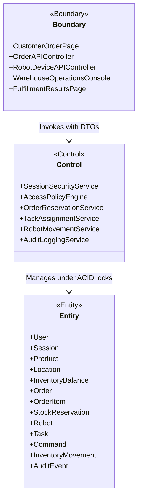
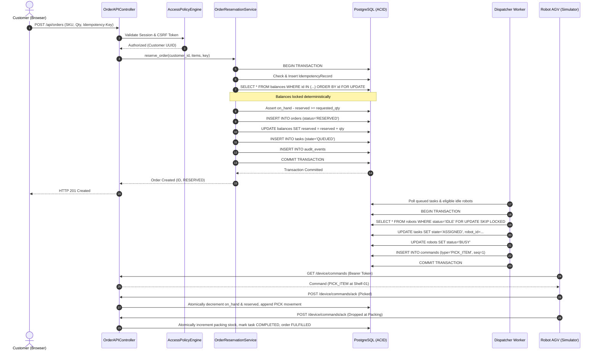

# Phase 3: Scenario-Based Analysis Model (SC-01)

**Course:** 24CYS401 – Secure Software Engineering  
**System:** 23. Autonomous Warehouse Management System  
**Document Ref:** `docs/03_analysis.md`  
**Marks:** 7 (part of Phase 3)  

---

## 1. Scenario Definition: SC-01 Place Order & Fulfillment Execution

In compliance with the examination instruction mapping (*"Attend Examination and Submit Answers"* → *"Place Order and Submit Fulfillment Request"*), Scenario SC-01 traces the complete business and security lifecycle from customer order placement to robot-assisted packing transfer.

---

## 2. Boundary-Control-Entity (BCE) Analysis

The system is decomposed into standard BCE stereotypes to guarantee strict separation of concerns, defensive validation, and transactional data encapsulation:

### Detailed BCE Descriptions

#### Boundaries (Presentation & Interface Layer)
1. **`CustomerOrderPage` / `OrderAPIController`:** Ingests HTTP requests, parses JSON payloads, validates client-side session cookies and anti-CSRF headers.
2. **`RobotDeviceAPIController`:** Ingests robot telemetry and step acknowledgments, validating device bearer tokens against hashed digests.
3. **`WarehouseOperationsConsole`:** Renders warehouse operational grid, task queues, and pause/resume controls for Operators and Managers.
4. **`FulfillmentResultsPage`:** Renders customer order fulfillment receipts and tracking logs with strict tenant-isolation filtering.

#### Controls (Domain & Business Logic Layer)
1. **`SessionSecurityService`:** Manages opaque session verification, CSRF token validation, brute-force rate-limiting, and cryptographic password checks.
2. **`AccessPolicyEngine`:** Evaluates centralized deny-by-default role permissions and object-level ownership predicates.
3. **`OrderReservationService`:** Executes atomic all-or-none inventory balance reservations under deterministic PostgreSQL row locks.
4. **`TaskAssignmentService`:** Validates robot eligibility (heartbeat, battery, status), locks records, assigns tasks, and issues sequenced commands.
5. **`RobotMovementService`:** Simulates discrete 2D grid coordinates, verifies cell occupancy, prevents collisions, and commits physical movements.
6. **`AuditLoggingService`:** Records attributable, immutable security and operational audit events in the database.

#### Entities (Persistence & Domain Model Layer)
1. **`Order` & `OrderItem`:** Represent customer purchase commitments and requested SKU quantities.
2. **`InventoryBalance`:** Tracks `on_hand` and `reserved` stock per product and location.
3. **`StockReservation`:** Ties an order item to a specific warehouse storage location.
4. **`Robot`:** Represents the physical automated device, its position `(x, y)`, battery, status, and credentials.
5. **`Task`:** Represents the stateful workflow (`QUEUED` → `ASSIGNED` → `TO_PICKUP` → `PICKING` → `TO_DROP` → `DROPPING` → `COMPLETED`).
6. **`Command`:** Allowlisted instructions sent to the robot with strictly ordered sequence numbers.
7. **`InventoryMovement`:** Append-only ledger recording physical transfers (`PICK`, `DROP`, `ADJUSTMENT`).

---

## 3. Sequence & Concurrency Analysis

### 3.1 Normal Success Path Sequence

### 3.2 Competing Concurrent Requests Failure Analysis
When two customers submit orders for the last remaining unit of an item simultaneously:
1. Transaction 1 acquires row lock on `inventory_balances` first via `SELECT ... FOR UPDATE`.
2. Transaction 2 is blocked by PostgreSQL row lock waiting for Transaction 1 to complete.
3. Transaction 1 reads `available = 1`, increments `reserved = 1`, commits, and releases lock.
4. Transaction 2 wakes up, reads updated row state: `available = 0`.
5. Transaction 2 triggers exception condition, rolls back all changes, releases lock, and returns HTTP 409 Conflict.
6. **Invariant Maintained:** Zero inventory overselling; database integrity preserved.
